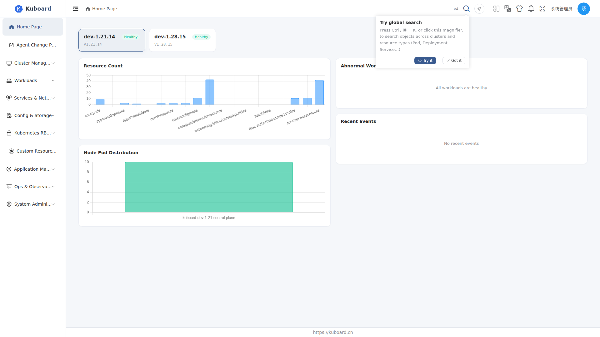
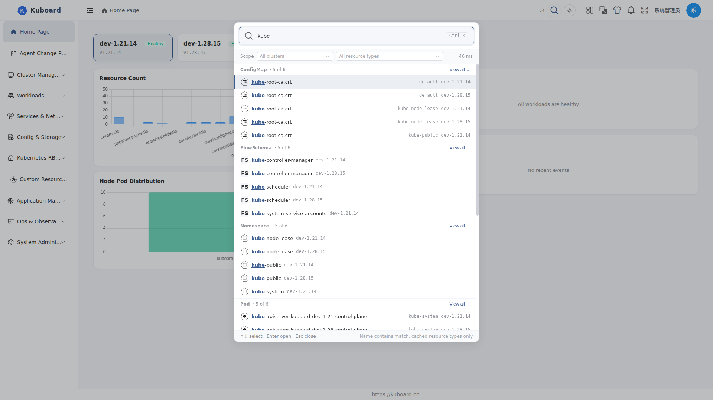

# Global Search

Press **Ctrl+K** (**⌘K** on Mac) or click the magnifier icon in the top toolbar to open global search and look up Kubernetes objects across clusters and resource types by name; type a keyword to locate and jump to an object.

Intended for operators and platform engineers who frequently look up objects across many clusters and namespaces; any account with at least one accessible cluster can use it.

## Opening Search

| Method | Action |
| --- | --- |
| Shortcut | Press **Ctrl+K** (**⌘K** on Mac); it does not take effect inside editable areas such as inputs, terminals, or editors |
| Icon | Click the magnifier icon on the right side of the top toolbar |
| First-login guide | The first time you open it after signing in (and your account has an accessible cluster), a "Try global search" bubble appears next to the icon — click **Try it** to open search directly, or **Got it** to never show it again |

The overlay is laid out from top to bottom as: input field → scope bar (clusters / resource types) → result area → hint bar.

## Search Scope

Global search matches by **name containment** (typing `nginx` also matches `nginx-deploy`) and follows these boundaries:

| Boundary | Description |
| --- | --- |
| Clusters | By default searches all clusters the current account can access; you can tick specific clusters in the scope bar |
| Resource types | By default searches all cached resource types; you can tick specific types in the scope bar |
| Permissions | Clusters / resource types without `list` permission are skipped automatically and never appear in results |

::: tip Why cached resource types only
Object data comes from the cache that the cluster syncs automatically (see [Resource List Pages](./object-list), "Cached vs Direct Data"). Resource types without sync configured are not covered by search; you can enable caching for a resource type in **Settings → System Settings → Cluster Cache Settings**, under "Caching resources settings".
:::

Common types cached by default and covered by search: Pods, Deployments, StatefulSets, DaemonSets, Namespaces, Events, CRDs and more.

## Usage Steps

1. Press **Ctrl+K** (or click the magnifier) to open the search overlay;
2. Type a keyword (up to 128 characters; the search runs automatically about 0.2 s after you stop typing);
3. To narrow the scope, tick **clusters** or **resource types** on the right of the scope bar — unchecked means all; your selection is remembered and kept after a page refresh;
4. Results are grouped by resource type; each group header reads "Kind · N of M" — when the hit count exceeds the displayed number, a **View all →** link appears at the end of the group; clicking it jumps to that type's list page;

5. Move between results with **↑ / ↓**, open the selected object with **Enter**, close the overlay with **Esc**; you can also click a result row directly;
6. Clicking a result locates the object in the following order:

| Destination | Behavior |
| --- | --- |
| Detail page | Resources with a detail page (e.g. Deployments, Pods) open the detail page directly |
| List page | Resources without a detail page (e.g. Endpoints) open that type's list page; the group header notes "No detail page · opens list" |
| Read-only YAML | Resources with neither a detail page nor a list page open as read-only YAML inside the overlay |
| Cannot open | When the current account lacks read permission, a hint is shown and nothing navigates |

## Recently Visited

When the overlay opens with no keyword typed, it shows **Recently visited** — objects you have opened are recorded locally per account; click one to jump again. With no history it shows "Type a keyword to search".

## FAQ

**Cannot find the object you are looking for?**

- Make sure the resource type has caching enabled (see "Search Scope") — uncached types are not covered;
- Make sure the current account has `list` permission on that cluster and type;
- Global search matches by name containment only; it does not search labels, annotations, or field contents. The "Include label search" and "Advanced search" actions on the UI are reserved for future versions;
- Overly long keywords are truncated to 128 characters.

**Results are empty but you want to widen the scope?**

Click **Search all clusters** below the result area to clear the cluster selection and search all clusters again.

**Why do result rows sometimes omit the cluster name?**

When exactly one cluster is selected the name is not repeated; when several clusters are selected or the system has more than one cluster, each result row shows its cluster.
