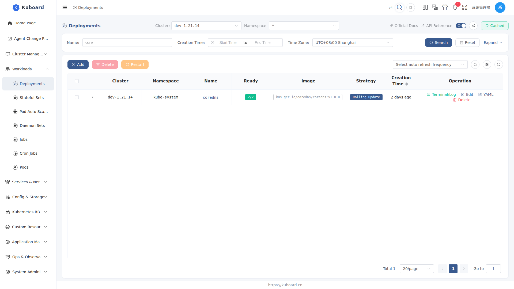

# Resource List Pages

Every Kubernetes resource list page in Kuboard — Deployments, Pods, ConfigMaps, CRDs and so on — follows the same page structure, so the interactions and operations are identical everywhere. This page summarizes those commonalities; resource-specific fields and actions are covered in the relevant sections of this guide (e.g. [Deployments](./../workload/deployments)).

## How to Open

Open the list page of any resource from the left menu (for example **Workloads → Deployment**). The page is laid out as follows, from top to bottom:

| Area | Contents |
| --- | --- |
| Title bar | Resource name + links to the [Kubernetes official documentation](https://kubernetes.io/docs) (concepts + API reference) |
| Toolbar | Scope-mode (multi-scope / single-scope) segmented control, cache status, auto-refresh, create and batch-action buttons, CSV export |
| Data area | Multi-scope: the resource tree on the left; single-scope: cluster / namespace selectors + the resource table |

## Scope Mode: Multi-Scope / Single-Scope

The **Scope mode** control in the toolbar is a segmented switch that decides *which clusters / namespaces this query covers*. Your choice is remembered for next time (older versions called these "tree mode / search mode"; the capability and URL parameters are unchanged):

| Mode | How you pick the scope | Good for |
| --- | --- | --- |
| **Multi-scope** | The left side shows a cluster → namespace tree (namespaced resources) or a cluster tree (cluster-scoped resources); you can tick **several** clusters / namespaces at once. When collapsed, the button shows "Scope · N" | Comparing several namespaces, cross-cluster troubleshooting |
| **Single-scope** | Queries **one namespace in one cluster** (the namespace can be `all`); filter conditions live in an inline **Filter** card above the table | Many clusters / namespaces but you only care about one spot; also the fallback when a list page fails to load because the request is too long |

::: tip Switching from multi-scope to single-scope
The switch takes the **first** item of your current selection and shows "Narrowed to `cluster/namespace` (was N)" at the top — it does not silently drop your selection, nor decide for you which ones to keep. Use "Back to multi-scope" when you need several namespaces at once.
:::

::: tip Resource availability
In multi-scope mode, if the current resource is not installed on a cluster (e.g. the cluster has no Gateway API), the corresponding node shows a ⚠ icon; hovering it reveals an installation guide.
:::

## Cached vs Direct Data

List data comes from one of two channels, shown by a "use cache / no cache" label at the top of the page:

| Channel | Description | Pagination |
| --- | --- | --- |
| **Cached list** | Resources configured for automatic sync (e.g. Pods, Deployments, Namespaces); the list is read from the Kuboard cache for fast access | Full-cluster search and pagination supported |
| **Direct list** | Resources without caching (mostly low-frequency and custom resources) are read directly from the cluster API; data is real-time | No pagination (the list footer shows "items that are not in the cache cannot be paginated") |

## Common Columns

Every list page has the following common columns:

| Column | Description |
| --- | --- |
| **Name** | Click to open the detail page (when you have get permission); resources being deleted are shown with a strikethrough |
| **Namespace** | The namespace the resource belongs to (namespaced resources) |
| **Creation time** | Displayed in the selected cluster's time zone |
| **Alive status** | Alive / dead marker (some resources) |
| **Operations** | Edit (when the resource has an edit page), View YAML, Delete; resource-specific actions (e.g. restart, scale) appear as extra buttons next to them |

## Common Operations

- **Create**: the **Add** button in the toolbar, via a form or a YAML wizard depending on the resource type;
- **Edit / View YAML / Delete**: in the row's operations column;
- **Batch operations**: select rows and act on all of them, e.g. batch delete — the confirmation dialog distinguishes "items in the cluster" from "items in the cache" and handles them separately; workloads also support batch restart, etc.;
- **Auto refresh**: the auto-refresh button in the toolbar; append `?autoRefresh=true` to the URL to enable it as soon as the page opens.

## Export to CSV

The **Export CSV** button at the end of the left-hand action group downloads the current list as a `.csv` file, using the range and columns you pick.

**Export range** — choose one:

| Range | Where it is generated | Notes |
| --- | --- | --- |
| Selected (N items) | Frontend | Only the rows you ticked; disabled when nothing is selected |
| Current page (N rows) | Frontend | Only the current page (row count follows your page-size setting) |
| Current filter result | Server | Runs the current search / advanced-filter conditions on the server, **not limited by pagination** |
| All | Server | Every item in the current scope, **filter conditions ignored** |

> Server-side export initially covers **nodes / pods / deployments** only. For other resources, "Current filter result / All" show "Provided in a later version"; use "Selected / Current page" instead.

**Export columns**: pick the columns in the dialog (all selected by default). Structural columns — selection, expand, index, radio, operation — are never exported; the dialog notes "N column(s) are display only". Column values are the same ones the table uses, so the column set is identical across ranges.

**Format and limits**:

- UTF-8 with BOM, RFC 4180 escaping (commas / quotes / newlines / Chinese text open correctly in Excel); numbers are exported without unit suffixes;
- Hard limit of **10,000 rows** per export: when the result is larger the dialog warns "Result is about N rows; only the first 10,000 rows will be exported" and requires you to tick "I understand that only 10,000 rows will be exported" — it never truncates silently or produces a half-written file.

**Permissions and auditing**:

- Data is scoped by your RBAC permissions: scopes you cannot read are **skipped** rather than failing the whole export, and the response header `X-Kuboard-Skipped-Scopes` carries the skipped count;
- When no scope is readable at all the endpoint returns 403 (a JSON error body) instead of an empty file;
- Every export writes an audit event; filter by resource on the **Audit** page to review them.

::: tip Export and filters share one source
The row count of a "Current filter result" export matches the "N items (filtered)" counter on the list; the export itself never changes your filters or selection.
:::

## Filters Are Synced to the Address Bar

The filter conditions of a list page (search keyword, cluster and namespace selection, page size) are **synced to the browser address bar**:

- Changing a filter updates the address bar; a cleared condition is removed from it;
- Copy the address-bar link and send it to a colleague — they open **the same set of data**;
- Returning from a detail page to the list keeps your filters, so you do not have to pick them again.

The parameters that appear in the address bar:

| Parameter | Meaning |
| --- | --- |
| `mode` | Scope mode: `search` (single-scope) or `tree` (multi-scope); values from older links still work |
| `clusterId` / `namespace` | The cluster and namespace selected in single-scope mode |
| `scopes` | The cluster / namespace nodes selected in multi-scope mode |
| `pageSize` | Number of rows per page |
| Filter conditions | One parameter per filter (e.g. name keyword, creation time range), named after the corresponding field in the table's filter boxes |

::: tip Share button
Both the list page and the resource detail page have a **Share** button next to the title — clicking it copies the current address-bar link (dropping parameters that only affect you, such as auto-refresh), with a confirmation toast. Use it instead of assembling a link by hand.
:::

## Permissions

- Every button on the list page is shown / hidden automatically according to the current user's RBAC permissions; unauthorized actions simply do not appear;
- If the current user has no `list` permission on the whole cluster, the page shows "Limited authorities" at the top — pick a namespace you have access to in the namespace selector.