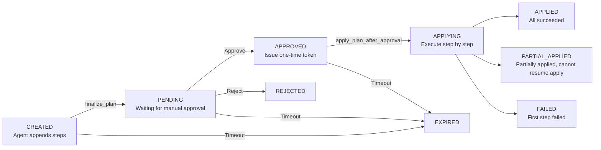

# Agent Change Approval Flow

An agent cannot modify the cluster directly: it first submits a "Change Plan", and only after you approve it does the actual write happen.

This page is for **users who approve AI changes in the Kuboard Web UI** and **developers who configure the change flow for agents**. It expands on the "Agent Change Approval" section of the [MCP integration overview](./index).

## 5-Phase Flow Overview

A change plan's full approval flow (Approval Flow) consists of 5 phases, mapped to the various statuses of the plan on the server:



The plan moves forward one way along the arrows: the agent proposes a plan → you approve it in the UI → the agent receives the result and continues automatically → results are collected. Execution can land in one of three terminal states; "Rejected" or "Expired" voids the plan outright.

## Phase 1: The Agent Proposes a Plan

The agent builds and submits a plan using 3 tools:

1. **`create_plan(description)`** creates an empty plan. `description` is the purpose of the operation shown to the approver (e.g. "restore the nginx deployment and open its port"), displayed at the top of the approval screen.
2. **`append_step_to_plan(planId, tool, args, description)`** appends each object to be changed as a step of the plan. A **dry-run rehearsal** is performed before appending:
   - Rehearsal passes → the step enters the plan;
   - The cluster does not support dry-run (Kubernetes 1.15~1.17) → degraded pass;
   - Rehearsal fails → the step is rejected; the agent must fix the parameters and retry, or drop the object.
3. **`finalize_plan(planId)`** submits the plan so it appears on the approval page. After submission, no more steps can be appended; an empty plan cannot be submitted.

The tools that can be appended form the **write-operation whitelist** (also the criterion for "whether approval is mandatory"):

```json
["apply_k8s", "patch_k8s", "delete_k8s", "delete_k8s_collection",
 "drain_node", "evict_pod",
 "restart_workload", "scale_workload", "rollback_workload"]
```

::: tip One plan = one operation intent
Try to aggregate all objects changed under one intent into the same plan, so you only approve once.
:::

## Phase 2: Approval in the Kuboard UI

After logging in to Kuboard, go to **"Agent Change Approval"** at the top of the left menu (path `/agent-change-plans`). Pending plans expand automatically, listing each step's purpose, cluster, namespace, resource, and action. You can perform three operations:

- **Approve all**: confirm without ticking anything — every step passes.
- **Approve selected**: untick the objects you do not want in the step checklist, then click **Approve Selected**. Unticked steps are skipped and nothing happens to them in the cluster; the confirm button is disabled when nothing is ticked.
- **Reject**: fill in a rejection reason (required) and the plan is voided — the cluster is not modified. Rejection is allowed in both the "pending approval" and "approved" states.

::: tip Approval must be done by you
Approving, rejecting, rolling back, and deleting plans only accept a **browser session**. The access key (Access Key) used by the agent is rejected for these operations — otherwise an agent could approve its own plan and the approval gate would mean nothing. Read-only queries are not affected.
:::

To abandon a plan that has already been submitted, reject it (cancellation is not currently open to users).

## Phase 3: The Approval Result Is Returned

Once you approve, the result is returned to the waiting agent automatically — **you do not have to copy any token by hand**:

- The agent blocks on **`await_plan_result(planId, timeoutSeconds?, sinceSeq?)`** waiting for your approval result. It waits 25 seconds by default and can wait up to 1800 seconds.
- Every return carries a **`nextAction`** telling the agent what to do next:

| `nextAction` type | When it appears | What the agent should do |
| --- | --- | --- |
| `loop` | Still waiting for approval / executing | Call `await_plan_result` again immediately |
| `call_tool` | Approved | Call the next tool named by `nextAction` |
| `stop` | Reached a terminal state | Report the result and finish |

A wait timeout (`timedOut=true`) is not an error — the agent should keep waiting rather than come back to you. Concurrent waits are subject to a quota (2 per user, 32 globally); when exceeded the call returns "busy" immediately without holding a request thread.

## Phase 4: The One-Time Token

After approval, the server issues a **one-time token** (approval token) for that plan. Token rules:

| Rule | Description |
|---|---|
| Format | `at-{uuid}`, e.g. `at-9f2c8e6d…` |
| Validity | 15 minutes; after that execution is rejected and re-approval is required |
| One-time | Consumed on execution; a second use errors out |
| Bound to the plan | Only usable for the plan it belongs to; a token from another plan is rejected |
| Holder only | Only the user who owns the plan can execute with it |
| Idempotent re-read | Approving again does not issue a new token — the original is returned |

After receiving the approval result, the agent calls **`apply_plan_after_approval(planId)`** to continue execution. The token may be omitted — the server reads the already-approved token of that plan automatically. If the administrator has turned off "auto-continue after approval", you must copy the token from the UI and the agent must pass it explicitly to `apply_plan(planId, approvalToken)`.

::: warning The token is a write authorization
The token is equivalent to authorization to write to the cluster — do not leak it to anyone other than the plan owner; if it is not used within 15 minutes it expires and re-approval is needed.
:::

## Phase 5: Step-by-Step Execution

During execution, the server advances through the steps in order:

- It validates that the token matches the plan and has not expired, then executes each step;
- Every completed step refreshes the execution progress on the approval page;
- **The first failure stops everything**: all remaining steps are marked as skipped.

Execution lands in one of three terminal states:

| Execution result | Terminal state |
|---|---|
| All steps succeeded | `APPLIED` |
| Partial success (stopped at the first failure) | `PARTIAL_APPLIED` |
| The very first step failed | `FAILED` |

::: danger No resuming apply after a partial success
If apply fails midway or the process is interrupted, the unexecuted steps are not retried automatically and you are never asked "should I continue" — you must create a new plan and go through the full approval again. This is deliberate, to avoid retrying failed changes without your knowledge.
:::

Special skip rules during execution:

- Steps unticked during partial approval → skipped;
- Steps that already succeeded or were already skipped → skipped (idempotent);
- Steps whose dry-run failed but that stayed in the plan → turned into skipped at execution time.

## Collecting Results

Once the plan reaches a terminal state, everyone collects the results:

**Agent side**

- The execution call returns the plan's terminal state with `applied` / `failed` / `skipped` counts, plus each step's status and error message;
- `get_plan_approve_status` is used before execution to check which objects were approved / skipped.

**User side (UI)**

- The list and detail views show each step's dry-run and execution result;
- **Rollback**: only valid for `PARTIAL_APPLIED` / `APPLIED` plans and only for `apply_k8s` steps that captured a pre-change snapshot — one click restores the previous state; created objects (which did not exist before) cannot be rolled back automatically;
- **Delete**: only allowed for plans that are "expired and not entirely successful" (physical deletion, unrecoverable); successfully executed plans are kept forever as evidence of the change.

## Timeouts and Recovery

::: tip
- A plan automatically expires if it is not processed within **30 minutes** (default), and the list status becomes "expired"; plans in the "building / pending approval / approved" states turn into expired when read.
- The token is valid for **15 minutes** after approval; after that execution is rejected and a new plan must be created and approved again.
- An apply that fails midway enters the `PARTIAL_APPLIED` terminal state — it can neither be batched further nor resumed; a new plan is required.
- Each user may hold at most **50** non-terminal plans at a time.
:::

## How Danger Levels Relate to Approval

Every plan and step carries a danger level:

| Level | Meaning |
|---|---|
| `LOW` | Read operations / single-resource restart or image change |
| `MEDIUM` | apply / patch / single-resource delete |
| `HIGH` | High-risk operations such as bulk deletion |

The danger level only affects how prominent the hint is in the approval UI (`LOW` blue / `MEDIUM` yellow / `HIGH` red); it **does not decide whether approval is mandatory**.

::: warning Whether approval is mandatory is decoupled from the danger level
The criterion is the **write-operation whitelist**: every MCP tool that performs a persistent write to the cluster is on that whitelist and must go through approval, regardless of its danger level — an operation marked `LOW` cannot bypass approval. See [danger level mechanism](./danger-levels). For the approval switch see [server configuration](./server-config).
:::

## Related Pages

- [MCP usage overview](./index)
- [MCP tools reference](./tools)
- [Danger level mechanism](./danger-levels)
- [Server configuration](./server-config)
