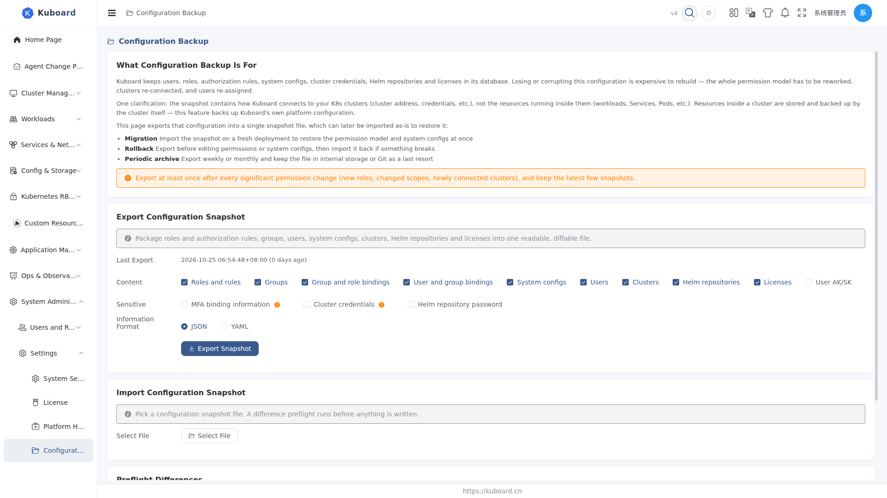
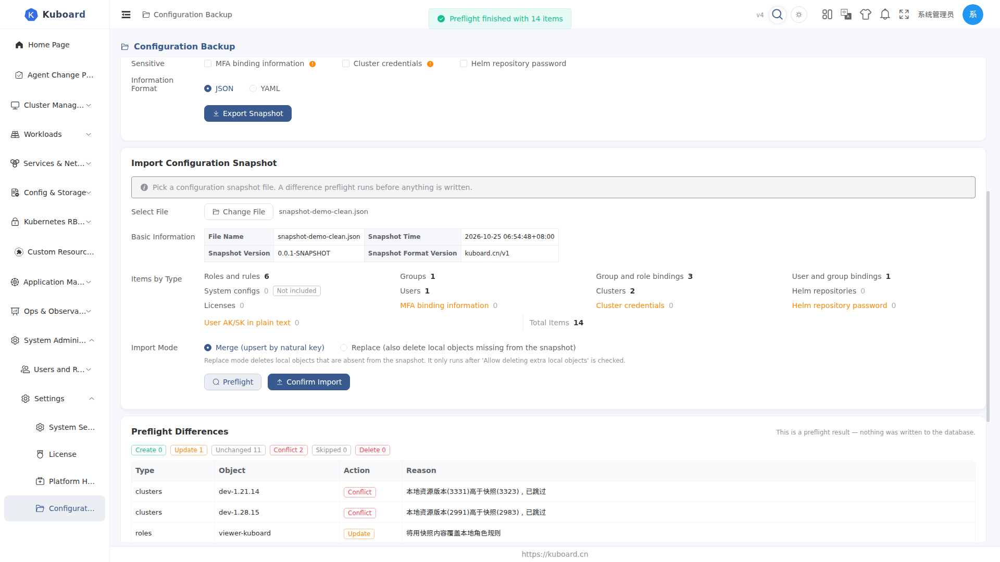

# Configuration Backup

Open the page under **System Administration → Settings → Configuration Backup**. It exports users, roles, authorization rules, system configs, cluster credentials, Helm repositories and licenses into a single snapshot file, which can be imported as-is to restore them later.

Intended for Kuboard administrators: **migration**, **rollback after mistakes**, and **periodic archiving**. The snapshot only covers Kuboard's own platform configuration — never the resources running inside your clusters (workloads, Services, Pods, etc.).

## Opening the page

1. After signing in, go to **System Administration → Settings → Configuration Backup**;
2. Exporting requires the **list** permission on `config.kuboard.cn / backup`, importing requires **create** (administrators have both by default; read-only roles can only export);
3. The menu item can be disabled under **Settings → System Settings → Menu Settings**; when disabled, the backup reminder guides you back to "Menu Settings" to restore it.

## Exporting a configuration snapshot

1. Check **Last Export**: shows the time of the most recent export and how many days ago; if none has ever been exported, a "No configuration snapshot has been exported yet" hint is shown.
2. Tick the **Content** items: by default, Roles and rules, Groups, Group and role bindings, User and group bindings, Users, Clusters, Helm repositories, Licenses and System configs are selected; **User AK/SK** is off by default — enable it manually when needed.
3. Tick **Sensitive Information** (all off by default; each option carries a warning):
   - **MFA binding information**: includes the TOTP seed (plain text) and recovery codes — anyone holding the file can generate that user's one-time codes;
   - **Cluster credentials**: includes the cluster kubeconfig / token (plain text);
   - **Helm repository password**.
4. Choose the **Format**: JSON (default) or YAML.
5. Click **Export Snapshot** → the browser downloads a `kuboard-config-snapshot-<time>.json` (or `.yaml`) file.

Export at least once after every significant permission change (new roles, changed scopes, newly connected clusters), and keep the latest few snapshots.

::: tip Snapshot contains no cluster resources
The snapshot contains how Kuboard connects to your K8s clusters (cluster address, credentials, etc.) — not the resources inside them. Resources inside a cluster are stored and backed up by the cluster itself.
:::

## Importing a configuration snapshot

1. Click **Select File** and choose a snapshot file (`.json` / `.yaml` / `.yml` supported).
2. Confirm **Basic Information** and **Item Counts**: the parsed file shows the snapshot time, source Kuboard version, snapshot format version and per-type item counts; data types absent from the snapshot are marked "not included", and items carrying sensitive fields get a "sensitive" tag.
3. Choose the **Import Mode**:
   - **Merge**: compare item by item by name — update what exists locally, create what does not (default);
   - **Replace**: additionally delete local objects that are not present in the snapshot; requires ticking "Allow deleting extra local objects" before it runs.
4. Click **Preflight** → lists per-item differences (create / update / unchanged / conflict / skipped / delete). Preflight **writes nothing to the database**.
5. When there are conflicts or Replace mode is selected, confirm a second time (the items to be deleted / conflicting are listed), then click **Confirm Import**.

After import you see "Configuration import completed"; permission, menu, cluster and AK caches are invalidated automatically — **no backend restart needed**. If permissions still look stale, clear caches manually on the "Platform Health" page.

## Sensitive information and security

| Item | Default | Notes |
| --- | --- | --- |
| JWT private key, OIDC encryption key | Never exported | Generated per deployment; exporting serves no purpose |
| Login shared secret, OIDC client secret | Masked | Shown as a placeholder in the snapshot; local current value is kept on import |
| MFA binding information (TOTP seed / recovery / emergency codes) | Not exported | Requires an explicit tick; anyone holding the file can generate that user's codes |
| Cluster credentials (kubeconfig / token) | Not exported | Requires an explicit tick |
| Helm repository password | Not exported | Requires an explicit tick |
| User AK/SK | Not exported | Requires an explicit tick |

Once sensitive items are exported, keep the snapshot file safe (leaking it equals leaking credentials). Snapshots are KB-sized and can be stored in Git, cloud drives or internal storage.

::: warning Clusters need credentials re-attached
After importing a snapshot without cluster credentials, the affected clusters are left without credentials: the import report lists them, and you must re-attach kubeconfig / token under "Cluster Management" and wait for a sync round.
:::

## Backup reminders

To prevent "nobody ever thinks about backing up", Kuboard offers two reminder channels:

| Channel | Where | Trigger |
| --- | --- | --- |
| Todo reminder (primary) | "Todos" tab in the header message center + badge | Appears when the last export is older than the reminder interval; clicking "Acknowledge" mutes it until now + the reminder interval |
| Health diagnostics finding (secondary) | "Issues" section of the Platform Health page | Reported as "Configuration has not been backed up for a long time" after the critical threshold |

The reminder policy is configured on the **System Administration → Settings → System Settings → Configuration Backup** tab:

| Setting | Default | Notes |
| --- | --- | --- |
| Enable backup reminder | On | Master switch; when off, neither the todo nor the health finding is produced |
| Reminder interval (days) | 7 | Remind in the message center when the last export is older than this |
| Critical threshold (days) | 30 | The health finding escalates to "critical" after this many days without an export |

The "last export time" comes from each moment a snapshot is successfully generated on the Configuration Backup page; never having exported counts as overdue and triggers an immediate reminder.

::: tip Reminder scope
The reminder targets every user with the export permission, regardless of user source; muting affects only the current user, not other administrators.
:::

## FAQ

| Symptom | How to handle |
| --- | --- |
| Permissions unchanged after import | Caches are invalidated automatically; if still stale, click "Clear cache" (authorization) on the Platform Health page — the current user's menu and permissions are rebuilt immediately |
| Restored cluster missing from list / data not refreshing | If the snapshot had no cluster credentials, re-attach credentials under "Cluster Management" and wait for a sync round |
| Worried about deleting local objects | Replace mode only deletes after ticking "Allow deleting extra local objects" and confirming a second time; run a preflight first and review the "to be deleted" list |
| "Snapshot format version mismatch" on import | The snapshot format version is incompatible with the current version (validated before import); use a snapshot from the same version |
| "Configuration Backup" menu not found | It may be disabled under Menu Settings; restore it at **System Administration → Settings → Menu Settings** |

The interfaces used on this page belong to the `config.kuboard.cn` group (System Configuration APIs); see the [API overview](../reference/api).
