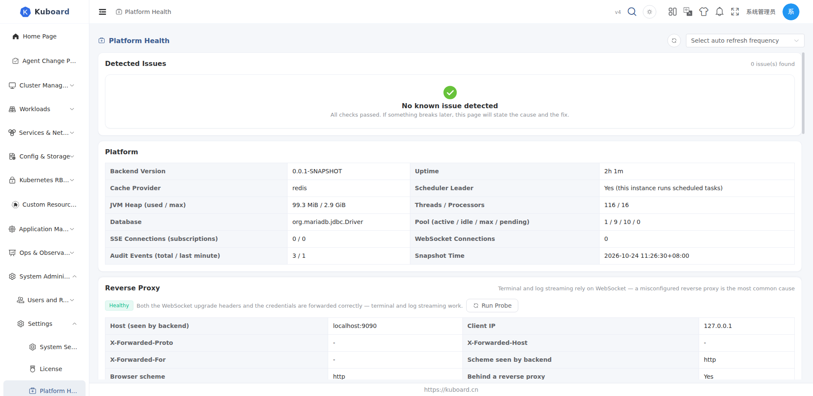

# Platform Health Diagnostics

Open **Settings → Platform Health** to see the platform gather scattered runtime facts — caches, cluster sync, License, database pool, reverse proxy — into a single-screen snapshot: when something is wrong, it states the cause and offers a one-click fix, without digging through logs or config files.

Aimed at Kuboard administrators for troubleshooting: after an upgrade, when menu or permission changes do not take effect, when list data looks stale, or when the terminal will not open — start here.

## Opening the Page

1. Sign in and go to **Settings → Platform Health**;
2. The page requires **list** permission on `health.kuboard.cn / diagnostics` (administrators have it by default);
3. The menu item can be disabled in **Settings → System Settings → Menu Settings** (it then disappears from the left menu).

The page runs top to bottom: **Detected Issues → Platform → Reverse Proxy → Clusters → Cache Resources → Common Issues**.

## Detected Issues

The platform detects problems across the following dimensions automatically and sorts them by severity (**Critical > Warning > Info**):

| Dimension | Example of a detected issue |
| --- | --- |
| Menu cache | Menu definition changed but the cache was not refreshed; menu cache too old (more than 24 hours) |
| Authority cache | Roles / user groups changed but the authority cache was not invalidated ("permissions changed but no effect") |
| Cluster cache & sync | Unhealthy cluster cache, failed sync task, incremental sync (watch) possibly interrupted, slow full sync |
| License | Expired, expiring soon (within 30 days), or not enough cluster capacity (per-site License count + 3 free per site) |
| Database pool | Active connections near the limit, waiting threads piling up |
| Reverse proxy | WebSocket upgrade headers lost, handshake rejected, missing `X-Forwarded-Proto`, rewritten Host, failed browser probe |

When everything is fine, the page shows "No known issue detected".

Each issue entry shows: severity, title, evidence (time / cluster / resource involved, etc.) and a fix button. Clicking the fix button applies it immediately — **no backend restart needed**.

## One-Click Fixes

| Action | Effect |
| --- | --- |
| Clear cache | Clears the menu cache or the authority cache; "Clear all caches" also clears system config, resource-type mapping and other caches |
| Restart full sync | Rebuilds the sync tasks for all cached objects of that cluster |
| Check connectivity | Verifies reachability of that cluster's apiserver (whether import parameters are correct and the network is reachable) |

::: tip Multi-instance deployments
Caches live in the single-instance local store by default, so clearing affects only the current instance; with `KUBOARD_CACHE_PROVIDER=redis` the cache is shared and clearing applies to all instances.
:::

## Platform

| Metric | Description |
| --- | --- |
| Backend version / uptime | Version number, how long since startup |
| Cache provider / scheduler leader | Cache implementation (local / redis), whether this instance is the scheduler leader |
| JVM heap / threads | Heap used and max, thread count and processor count |
| SSE / WebSocket connections | Connection counts of this instance |
| Audit writes | Total written / written in the last minute |
| Database pool | Active / idle / max / waiting |
| Snapshot time | When this snapshot was generated |

::: tip About connection counts
SSE and WebSocket connections are held by the process, so in a multi-replica deployment this page shows the numbers of the **current instance**; check each instance separately.
:::

## Reverse Proxy

Terminal and log streaming rely on WebSocket, and a misconfigured reverse proxy is the most common fault source. This section answers "which link of the chain is broken":

**Browser probe**: click **Run Probe** to start from your current browser and check the "browser → reverse proxy → Kuboard" chain in three steps:

| Step | What it checks |
| --- | --- |
| 1. Reachability | Whether the request reaches the Kuboard backend |
| 2. Upgrade forwarding | Whether the WebSocket upgrade headers (Upgrade / Connection) are forwarded |
| 3. Auth forwarding | Whether the credential (access_token) reaches the backend |

Probe conclusions: **OK**, **Upgrade headers not forwarded**, **Path not routed**, **Auth not forwarded**, or **Idle timeout too short** — each with the matching cause and fix hint.

**Server-side observation**: the backend counts occurrences and last-seen times of "upgrade headers lost" and "handshake rejected" (per instance), useful for cross-checking against proxy logs and packet captures.

See the "How to fix" section in this panel for [Nginx / Ingress configuration samples](../install/reverse-proxy).

::: tip Scope of the probe
The probe reflects the single "current browser → current proxy → Kuboard" chain; validate each entry / proxy separately in multi-ingress deployments.
:::

## Clusters

One row per cluster, showing K8s version, cache health, import status, sync issues, cached object count, last full sync and the apiserver address; the action column provides "Restart Full Sync" and "Check Connectivity".

## Cache Resources

Lists each resource type's sync mode (**Watch / Polling / No cache**), polling interval, full/incremental sync status and watch heartbeat. Resources without cache are not auto-synced and their list data is read directly from the cluster (see [Resource List Pages](../guide/ui/object-list), "Cached vs Direct Data").

## Common Issues

| Symptom | Fix |
| --- | --- |
| A newly installed CRD is missing under "Custom Resources" on the left | Check "Detected Issues" for an unhealthy cluster cache or sync failure, click "Restart Full Sync", then refresh |
| Role permission changes have no effect for users | Click "Clear cache" (authority) here — the current user's menu and permissions are rebuilt immediately |
| List data has not changed for a long time | "Restart Full Sync" for that cluster; run "Check Connectivity" first if the apiserver is unreachable |
| The whole platform responds slowly | Look at the pool numbers under "Platform"; when saturated, restarting full sync usually relieves it right away |
| Pod terminal will not open, logs invisible | Click "Run Probe" under "Reverse Proxy" to find the broken link, then fix the proxy configuration |

The interfaces involved in this section (`health.kuboard.cn`) are not listed among the existing Swagger UI groups; see the [API documentation overview](../reference/api) for access.