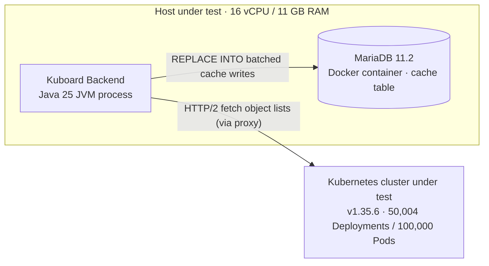

# Full Sync Performance on a Large Cluster

This page documents measured results of "Restart Full Sync" on an extra-large Kubernetes cluster with Kuboard V4, covering the **total duration** and the **resource consumption curves of the backend and the database**, as a reference for capacity planning and deployment sizing.

Audience: cluster operators / administrators and capacity planners. For how the sync mechanism works, see [Cluster Sync & Cache](../guide/cluster/sync-status).

## Test Environment & Scale

| Item | Value |
| --- | --- |
| Kubernetes cluster | Test cluster, v1.35.6 |
| Object scale | **50,004 Deployments, 100,000 Pods** (150,152 cached rows in total) |
| Kuboard backend | Single instance; **actual process usage**: RSS ~556 MB at baseline → ~757 MB at sync peak, JVM heap peak ~313 MB, CPU peak ~168% (~1.7 cores) |
| Database | MariaDB 11.2 (container); **actual process usage**: RSS ~716 MB at baseline → ~748 MB at peak, CPU peak ~186% (~1.9 cores); cache is stored in `kb_cluster_sync_data` |
| Deployment | Backend and database run on the **same host** (16 cores / 11 GB RAM); all resource figures on this page are actual per-process / per-container usage, not host-machine specs |
| Sync tasks | 32 resource tasks (excluding the manager task) |

::: tip What is RSS?
**RSS (Resident Set Size)** is the amount of **physical memory** a process currently occupies (in MB) — the most direct measure of a process's memory footprint. It excludes pages swapped out to disk and is far smaller than the process's virtual memory (VSZ). All "RSS" figures on this page were measured from the actual processes: the Java process for the backend, and the `mariadbd` process inside the container for the database.
:::

## Deployment Topology & Machine Configuration

### Deployment Topology

The system under test is a **co-located deployment of the Kuboard backend and the MariaDB database**, sharing one host machine with 16 vCPUs / 11 GB RAM. The backend runs as a Java JVM process (single spring-boot instance, dev mode), and the database runs as a Docker container. During a full sync, the backend fetches object lists from the Kubernetes cluster under test over HTTP/2 (through a proxy), parses them, and commits them to the database cache table via batched `REPLACE INTO` statements.

::: tip Why co-location matters
Because the backend and the database share the host's CPU and memory, this page measures resource consumption with **actual per-process / per-container usage** (rather than host-machine specs), so the figures can be used directly to size the resources a single machine needs for production deployment.
:::

### Machine Configuration

| Item | Configuration |
| --- | --- |
| Operating system | Ubuntu 24.04.5 LTS (kernel 6.8.0-146-generic) |
| CPU | 16 vCPUs (Intel Core i5-14400, cloud-virtualized environment) |
| Memory | 11 GB (~5 GB available during the test) |
| Disk | **240 GB SSD** (virtio virtual disk on a cloud VM; LVM root volume 234 GB, ~49% used at test time) |
| Kuboard backend | Java 25 JVM process (single spring-boot instance, no CPU / memory limits) |
| Database | MariaDB 11.2 container (no CPU / memory limits) |

::: warning Measurement environment note
During the test, the host machine also ran idle containers such as Redis and local kind test clusters (no material impact on the measurements); the cluster under test (`k8s-135`) is remote and is reached through a proxy from the backend. In production, actual resource usage may be higher if the host carries other workloads.
:::

## Method & Instrumentation

- **Operation**: call "Restart Full Sync" — `POST /api/cluster.kuboard.cn/v4/cluster/{uid}/restart-full-sync`. The scheduler re-discovers cluster `/apis`, re-creates sync tasks for every resource, and performs a full refresh one resource at a time.
- **Duration source**: `full_sync_start_time / full_sync_end_time` of each task in `kb_cluster_sync_task`.
- **Backend sampling**: process CPU / RSS from `/proc`, JVM heap & GC from `jstat`, at 2 s granularity.
- **Database sampling**: CPU / RSS from `/proc`, container disk I/O from cgroup `io.stat`, InnoDB counters from `information_schema.GLOBAL_STATUS`.

## Full Sync Duration

| Metric | Result |
| --- | --- |
| **Trigger → all tasks complete** | **~214 s** (3 min 34 s) |
| `deployments` | 125.0 s, 50,004 objects (~400 objects/s) |
| `pods` | **208.9 s**, 100,000 objects (~479 objects/s) |
| Remaining 30 resources | < 1 s each |
| Aggregate write rate | ~700 objects/s |

`deployments` and `pods` run **concurrently**; the total time is determined by `pods` (208.9 s). Incremental watch resumes automatically after the full sync; all 32/32 tasks succeeded.

## Backend Resource Consumption

Backend CPU averages ~79% during the sync, with the peak in the middle-to-late phase (the `pods` large-object write phase); during the earlier `deployments` phase, pressure sits mostly on the database side.

| Metric | Baseline | Mean (sync) | Peak |
| --- | --- | --- | --- |
| Backend CPU | ~1.5% | 78.6% | **168.0%** (~1.7 of 16 cores) |
| Process RSS | 556 MB | 628 MB | **757 MB** |
| JVM heap used | 162 MB | 165 MB | **313 MB** |
| Heap committed | 220 MB | 283 MB | 408 MB |
| Young GC | — | +374 collections | +1.98 s pause, **0 Full GC** |

## Database Resource Consumption

The database is the other pressure point on par with the backend in this run: CPU averages ~84% with a peak of ~186% (slightly higher than the backend this time), disk write averages ~173 MB/s with a peak of ~404 MB/s.

| Metric | Baseline | Mean (sync) | Peak |
| --- | --- | --- | --- |
| Database CPU | 0.2% | 83.6% | **185.8%** (~1.9 of 16 cores) |
| Process RSS | 716 MB | 726 MB | **748 MB** |
| Disk write | ~0 | 173.1 MB/s | **404.1 MB/s** |
| Disk read | ~0 | 65.5 MB/s | **308.5 MB/s** |
| Cumulative I/O in sync | — | **~38.9 GB written** / ~14.7 GB read | — |

**InnoDB counter deltas** (during the sync window):

| Counter | Delta |
| --- | --- |
| `Innodb_data_read` | +15.8 GB |
| `Innodb_data_written` | +39.7 GB |
| `Innodb_data_fsyncs` | +37,193 |
| `Innodb_log_writes` | +7,507 |
| `Innodb_buffer_pool_reads` | +965 K |

**Write shape**: 150K cached rows are committed via **1,525 batched `REPLACE INTO` statements** (~98 rows per statement); peak `Threads_running` was only 3, with no connection/lock-wait concerns.

## Host Disk & Overall Assessment

- **Root device (dm-0, SSD)** write peak ~404.2 MB/s / read peak ~308.5 MB/s, matching the database container I/O exactly → **disk pressure comes almost entirely from database writes**; the backend barely touches the disk.
- Backend and database share the same host; during the sync the two processes grew memory by **~233 MB combined** (backend +201 MB, database +32 MB), with per-process CPU peaks of ~1.7 cores (backend) and ~1.9 cores (database) — **no resource bottleneck**.
- Reproducible outcome: 32/32 sync tasks succeeded, no failures, no alerts, and incremental watch resumed automatically.

## Conclusions & Recommendations

- **Duration driver**: the `pods` full sync (208.9 s) essentially determines the total time (~214 s); the `deployments` full sync (125.0 s) runs concurrently.
- **Capacity planning**: at the scale of 50K Deployments / 100K Pods, treat **database disk write (peak ~404 MB/s, ~39 GB in total) and database CPU (peak ~186%) as the top concerns**, followed by backend CPU (~1.7 cores during the sync).
- **Re-testing**: reuse the instrumentation above (`/proc` + `jstat` + cgroup `io.stat` + InnoDB counters) for benchmarking at target scale; prefer running full sync during low-business-hours windows.
