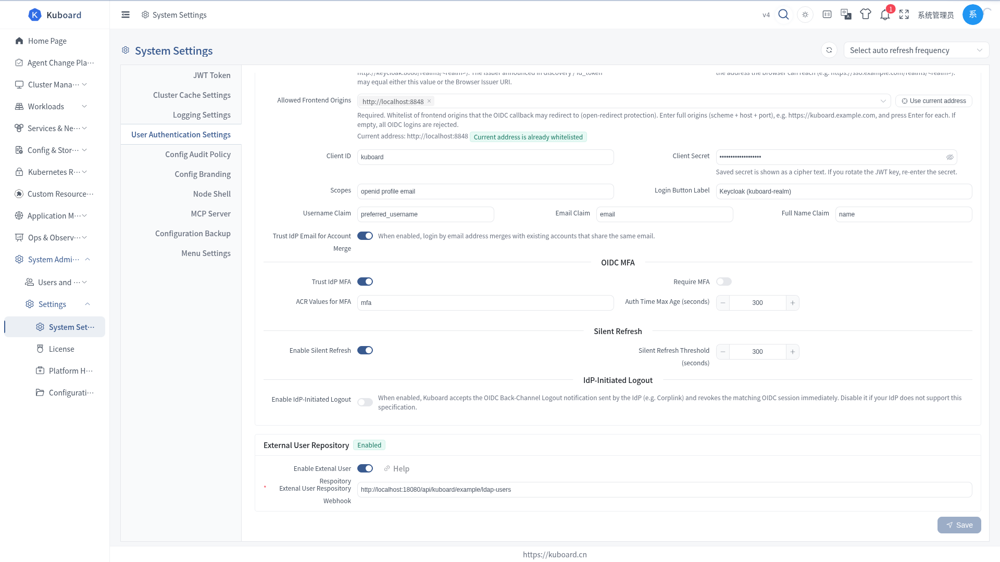
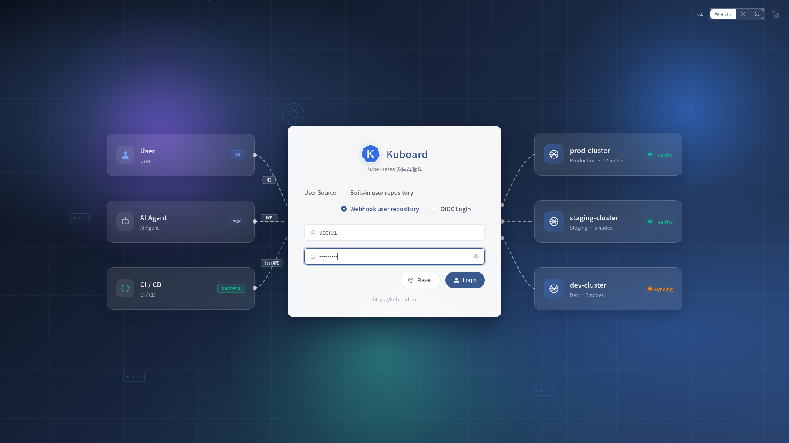
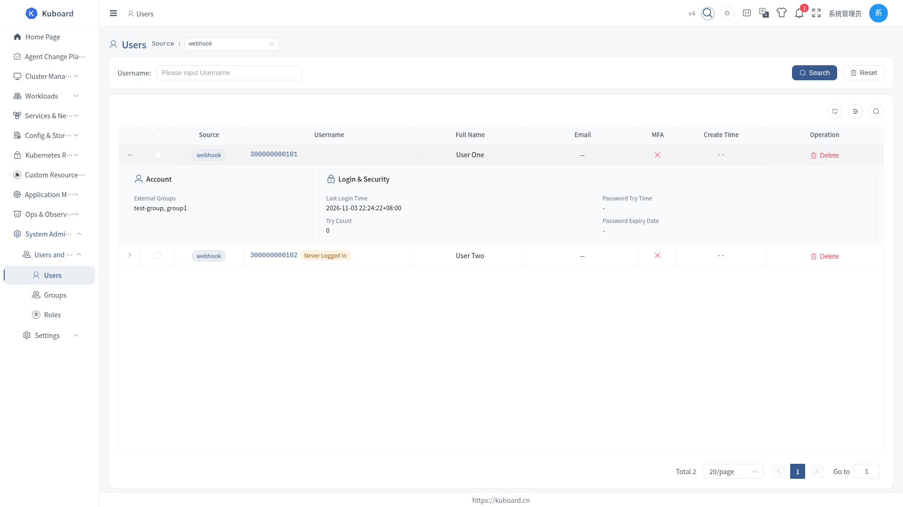

# Integrating LDAP via Webhook

This page explains how to connect an existing enterprise LDAP directory to Kuboard: users enter their LDAP account on the Kuboard login page, and the password is validated against LDAP.

**Audience**: Kuboard administrators; you need a runnable HTTP service that fronts the LDAP directory.

::: warning This Is Not Single Sign-On (SSO)
Users still type their username and password on the Kuboard login page; only the password validation is forwarded to LDAP. To let users sign in without typing a password, use [OIDC single sign-on](./oidc) instead.
:::

## Two Ways to Do This

| Approach | Who It Suits | What It Takes |
| --- | --- | --- |
| A. Run the official sample end to end | You want to confirm the Kuboard ↔ LDAP link works | Start the sample environment, change one setting, log in |
| B. Adapt it to your own LDAP | You already have LDAP and need a real integration | Modify the sample; field mapping is below |

Both work the same way: Kuboard forwards the login request to an HTTP address you provide (the "External User Webhook"), and that service queries LDAP on your behalf.

::: tip Be Careful If LDAP Already Enforces MFA
Kuboard's own MFA also applies to LDAP users: after LDAP validates the password, users are asked for a one-time code as well. If your enterprise already does multi-factor authentication in LDAP, use [OIDC single sign-on](./oidc) instead and let the identity provider handle it.
:::

## Approach A: Run the Official Sample End to End

### 1. Start the Sample Environment

```sh
git clone https://github.com/eip-work/kuboard-v4-ldap-example.git
cd kuboard-v4-ldap-example
docker compose up -d
```

The sample starts four containers:

| Container | Purpose | How to Reach It |
| --- | --- | --- |
| `openldap` | The LDAP directory | `ldap://openldap:1389` inside the Docker network |
| `kuboard-ldap-example` | The webhook service, translating LDAP queries into the format Kuboard expects | `http://ldap-example:9090/api/kuboard/example/ldap-users` inside the Docker network |
| `db` | The Kuboard database | `db:3306` inside the Docker network |
| `kuboard` | Kuboard itself | Open `http://localhost:8000` in your browser |

Two accounts are preloaded in the LDAP directory:

| Username | Password | Group |
| --- | --- | --- |
| `user01` | `password1` | `test-group` |
| `user02` | `password2` | `test-group` |

### 2. Enter the Webhook Address in Kuboard

1. Open `http://localhost:8000` and log in as `admin` / `Kuboard123`.
2. Go to **System Administration → Settings → System Settings → User Authentication Settings** and scroll to the "**External User Repository**" card at the bottom of the page.
3. Turn on the "**Enable External User Webhook**" toggle; the "**External User Webhook**" input appears below it.
4. Enter `http://ldap-example:9090/api/kuboard/example/ldap-users` and click "**Save**".



::: warning The Address Must Be Reachable from the Kuboard Server
This URL is requested by the Kuboard **backend**, not by the browser. Fill in an address the Kuboard server can resolve and reach; in the sample, Kuboard and the webhook service share one Docker network, which is why the service name `ldap-example` is used. Do not use `localhost`.
:::

### 3. Log In with an LDAP Account

1. Click your avatar in the top-right corner → **Log out**.
2. On the login page, under "**User Source**", select "**Webhook user repository**".
3. Enter `user01` / `password1` and click "**Login**"; reaching the home page means the link works.



::: tip Passwords Never Reach Kuboard
Kuboard only forwards the password to LDAP and stores nothing itself. A password changed in LDAP takes effect on the next login.
:::

### 4. Grant Permissions to LDAP Users

An LDAP user has **no permissions by default** after logging in (the home page is all they can see). Permissions are granted exactly as for built-in users: user groups + roles.

1. Go to **System Administration → Users and Roles → Users** and select "**webhook**" (the external user repository) in the "**Source**" dropdown at the top-left.
2. Find `user01` in the list, open it, switch to the "**User Groups**" tab, and click "**Add User-Group Binding**".
3. Select an existing Kuboard user group (create one first under **System Administration → Users and Roles → Groups** if needed), set an expiry date, and click "**OK**".



::: tip You Can Also Go the Other Way
On a group's detail page, use the "**Users**" tab and add `user01` as a member. On the first binding, Kuboard creates the local record for that LDAP user automatically — the user does not have to log in first.
:::

Once the group has roles bound to it, every member of the group gets those permissions immediately; see [User Groups](./groups) for how to bind roles.

## Approach B: Adapt It to Your Own LDAP

### What the Webhook Service Must Do

Implement **3 actions on the same HTTP address** (Kuboard only knows this one address):

| Action | Kuboard's Request | What You Return |
| --- | --- | --- |
| Authenticate | `POST {url}` with body `{"username": "...", "password": "..."}` | `{"code": 0, "message": "ok"}` |
| List users | `GET {url}?pageNum=1&pageSize=10&username=` | `{"code": 0, "data": {"list": [...], "pageNum": 1, "pageSize": 10, "total": 1}}` |
| Look up one user | `GET {url}?username=xxx` | Same shape, with only that user in `list` |

`code` decides how Kuboard reacts:

| code | Meaning | What Kuboard Does |
| --- | --- | --- |
| 0 | Success | Authentication passes / the list is returned normally |
| 1 | Authentication failed | Login rejected with "incorrect username or password" |
| 2 | User not found | Login rejected. To avoid revealing whether the account exists, return `code = 1` for unknown users too |
| 3 | Internal server error | The login page reports a gateway error |

See [Webhook External User Library](./webhook-users) for the full request and response fields.

### Which LDAP Attributes to Map

| Webhook Field | Corresponding LDAP Attribute | Required | Purpose |
| --- | --- | --- | --- |
| `username` | `uid` | Yes | The login name — how Kuboard identifies the user |
| `fullName` | `cn` | No | "Full Name" column in user management |
| `email` | `mail` | No | "Email" column in user management |
| `groups` | `memberOf` | No | Displayed as "External Groups" in user management; **grants no permissions by itself** |
| `createTime` | `createTimestamp` | No | "Create Time" column in user management |

### Adapting the Official Sample

The official sample is a Spring Boot application, so you only need to swap the LDAP queries for your own directory:

1. Clone the sample and change the LDAP connection parameters (see the table below).
2. Replace the hard-coded user groups with a read of `memberOf` (or whatever group attribute your directory uses).
3. Run `docker build -t <your-image-name>:v4 .` and push it to a registry the Kuboard cluster can reach.
4. Deploy that service on a network Kuboard can reach, and enter its address in Kuboard (same as step 2 of Approach A).

The sample's connection parameters:

| Environment Variable | Meaning | Sample Default |
| --- | --- | --- |
| `LDAP_URL` | LDAP server address | `ldap://localhost:1389` |
| `LDAP_USERNAME` | Account used to bind to LDAP | `cn=admin,dc=kuboard,dc=cn` |
| `LDAP_PASSWORD` | Bind password | `Kuboard123` |
| `LDAP_BASE` | Base DN where the users live | `ou=users,dc=kuboard,dc=cn` |

## Common Problems

| Symptom | Cause | What to Do |
| --- | --- | --- |
| No "Webhook user repository" option on the login page | "Enable External User Webhook" is off, or the change was not saved | Go back to User Authentication Settings, confirm the toggle is on and saved |
| Login keeps saying the username or password is wrong | The webhook address is unreachable, or LDAP rejected the credentials | On the machine running Kuboard, run `curl -X POST <address> -H 'Content-Type: application/json' -d '{"username":"user01","password":"password1"}'` and check the returned `code` |
| Login reports a gateway error | The webhook service returned `code=3` or threw an exception | Check the webhook service logs |
| No LDAP users in user management | The "Source" dropdown was not switched to the external user repository | Select "webhook" in the "Source" dropdown; the list is fetched from LDAP live every time it is opened |
| An LDAP user logs in and sees nothing | No user group is bound | Go to Users and Roles → Users, find the user, and bind a user group |
| Password changed in LDAP but Kuboard still rejects it | The webhook service cached the old password | Check the webhook service's cache; Kuboard itself does not cache passwords |

## Security Recommendations

::: danger The Webhook Receives Plaintext Passwords
User passwords are POSTed in plaintext to the address you enter. Always use HTTPS, restrict the source IPs, and never put sensitive information in the returned `message` / `details`.
:::

- Bind to LDAP with a **read-only** account: the webhook service only needs to look up users and groups.
- Kuboard can attach an HMAC signature to requests sent to the webhook (the `webhookSharedSecret` configuration item). The field is not exposed in the UI yet and must be written through the system configuration API; once set, have the webhook service verify the `X-Kuboard-Webhook-Signature` request header.
- To let users sign in without typing a password, use [OIDC single sign-on](./oidc) instead.

## Related Pages

- [Webhook External User Library](./webhook-users) — the webhook protocol's fields, return codes, enabling it, and verifying login
- [User Groups](./groups) — bringing LDAP users into a user group and binding roles
- [OIDC single sign-on](./oidc) — the other way to connect an external identity source without typing a password

The APIs involved in this section are described in the [Swagger UI "Authentication APIs" group](../reference/api).
