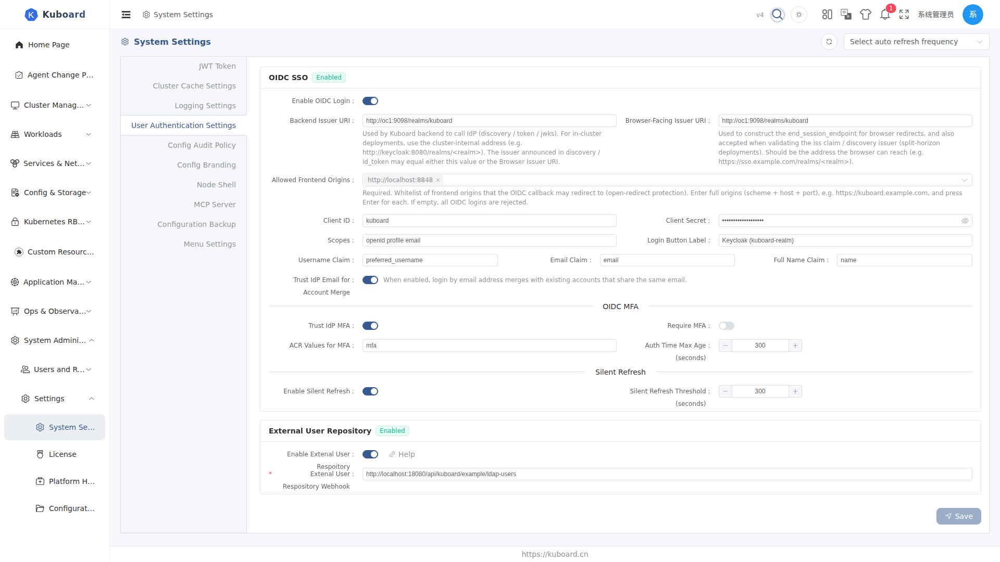

# Integrate with GitLab (OIDC SSO)

After connecting GitLab as the identity provider (IdP) for Kuboard, your team signs in to Kuboard with their existing GitLab accounts, no new Kuboard accounts needed. This page is for administrators: complete the configuration on the GitLab side and the Kuboard side in order.

**Audience**: Kuboard administrators.

**Prerequisites**:

- Kuboard is deployed and reachable from your browser (the examples below use `https://kuboard.example.com`);
- You have access to a GitLab.com account or a self-managed GitLab instance (GitLab's OIDC provider is available on the Free tier; CE and EE both work);
- You are familiar with the [OIDC SSO](./oidc) configuration entry in Kuboard.

## Configuration Flow

| Step | Where | What to do |
| --- | --- | --- |
| 1 | GitLab | Create an OAuth application, get the Application ID and Secret |
| 2 | Kuboard | Fill in the OIDC settings at Settings → User Authentication Settings → OIDC SSO |
| 3 | Both | Verify login with a GitLab account |

## Step 1: Create an OAuth Application in GitLab

Create an OAuth application in GitLab and register it as an OpenID Connect client. Pick the application type that fits your organization — all three work the same way, they only differ in visibility:

| Type | Where to create | Best for |
| --- | --- | --- |
| Group-level (recommended) | Group → Settings → Applications | Only group members can sign in |
| Instance-wide | Admin → Applications → New application | All members of a self-managed GitLab instance (Self-Managed only, requires administrator) |
| User-level | Avatar → Edit profile → Access → Applications | Personal testing |

Fill in the new application form:

| Field | Value |
| --- | --- |
| Name | `Kuboard` (any name) |
| Redirect URI | `https://kuboard.example.com/api/anonymous.kuboard.cn/v4/oidc/callback` |
| Scopes | Select `openid`, `profile`, `email` |

After clicking **Save application**, the page shows two values — copy and save them right away:

- **Application ID** — used as the Client ID in Kuboard;
- **Secret** — used as the Client Secret in Kuboard; it is shown only once at creation time.

::: tip Mark instance-wide applications as Trusted
When creating an instance-wide application under Admin → Applications, tick **Trusted** so members are signed in directly without an authorization confirmation page on first login.
:::

## Step 2: Fill In the OIDC Settings in Kuboard

Entry: **System Administration → System Settings → User Authentication Settings → OIDC SSO**. Turn on "Enable OIDC Login", then fill in the fields:

| Field | Value | Notes |
| --- | --- | --- |
| Backend Issuer URI | `https://gitlab.com` or `https://gitlab.example.com` | The root URL of your GitLab instance; no `/oauth`, no trailing slash |
| Browser-Facing Issuer URI | Same as above | Only set a different value when the browser and the backend reach GitLab at different addresses (split-horizon); otherwise keep it the same |
| Allowed Frontend Origins | `https://kuboard.example.com` | **Required**; type an origin and press Enter. Use the scheme + host + port you see in the browser's address bar when opening Kuboard |
| Client ID | Application ID from step 1 | |
| Client Secret | Secret from step 1 | |
| Scopes | `openid profile email` | The default is fine |
| Login Button Label | `GitLab` | The login button shows "Login with GitLab" |
| Username Claim | `nickname` | The GitLab username; `preferred_username` also works |
| Email Claim | `email` | The GitLab primary email |
| Full Name Claim | `name` | The GitLab display name |
| Trust IdP Email for Account Merge | On | Merges with an existing Kuboard account that shares the same email |

The settings take effect immediately after saving; no restart needed.

## Step 3: Verify Login

1. Sign out and go back to the login page. With OIDC active, the username / password fields are hidden and only the **OIDC** option remains.
2. Click **Login with GitLab**; the browser redirects to GitLab for authorization.
3. If an authorization page appears on first login, click **Authorize** (it will not appear for Trusted instance-wide applications).
4. You are redirected back to the Kuboard home page — signed in. In **Users**, filter the "Source" column by **OIDC** to see the new user.

**Pre-create accounts (optional)**: to assign roles / groups before the first login, click **+ Pre-create OIDC User** on the Users page and enter an email exactly matching GitLab (case-sensitive). After the first successful login, the placeholder is replaced by the real user and the assigned roles and groups are kept.

## Troubleshooting

### A user has no email or display name after login

GitLab only issues the `email` claim when the application has the `email` scope and the user has set a public email address in GitLab. Ask the user to add a public email in their GitLab profile; the login name is taken from the Username Claim and is unaffected.

### issuer mismatch or id_token_invalid

- Both Issuer URIs must be the root URL of the GitLab instance — no `/oauth`, no trailing slash;
- If your self-managed GitLab uses a self-signed certificate, the Kuboard backend must trust that certificate, otherwise discovery cannot be fetched;
- When internal and external addresses differ, put the browser-reachable address in "Browser-Facing Issuer URI".

### Callback returns 502 or redirect_uri does not match

- The **Redirect URI** in the GitLab application must exactly match `https://<Kuboard-domain>/api/anonymous.kuboard.cn/v4/oidc/callback` (scheme, domain and path all matter);
- The "Allowed Frontend Origins" in Kuboard must include the origin from the browser's address bar.

### Login fails with code_exchange_failed

The Client ID / Secret do not match GitLab (common after renewing the secret with **Renew secret** without updating Kuboard). Copy the values again and save.

## Related Pages

[OIDC SSO](./oidc) · [Login & Authentication Methods](./login) · [Users](./users) · [Groups](./groups)