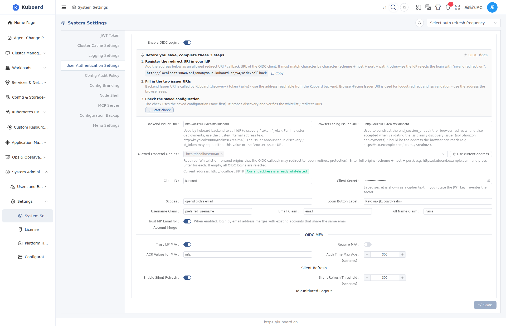

# Kuboard OIDC Single Sign-On (SSO)

This page explains how an administrator sets up OIDC single sign-on for Kuboard, how to verify the setup with the built-in self-check, how users sign in and out with their IdP account, and how to troubleshoot failed logins.

**Applicable to**: administrators (configure OIDC, manage OIDC users) and regular users (click **Sign in with XXX**).

## Integration at a Glance

Kuboard uses a **single-IdP** shape: every OIDC field lives on one card (**System Admin → Settings → System Settings → User Login Settings → OIDC SSO**) — no wizard tabs, no multi-IdP list.

| Step | Who | Where |
|---|---|---|
| ① Register the callback URL | Administrator | The IdP client's **Valid redirect URIs** |
| ② Fill in the OIDC card | Administrator | Kuboard System Settings → User Login Settings |
| ③ Save, then run the self-check | Administrator | **Start check** on the same card |
| ④ Click the button and sign in | User | **Sign in with XXX** on the login page |

Once **Enable OIDC Login** is on, the top of the card shows a "**Before you save, complete these 3 steps**" guide that puts ①②③ right above the fields: the callback URL can be copied with one click, and the last step is the **Start check** button. Follow the guide in order; the sections below explain each step.

## Users: Login & Logout

### Login

When OIDC is enabled and the whitelist is non-empty, the login page selects the **OIDC** user source by default and hides the username / password fields. Click **Sign in with {display name}** → the whole page jumps to the IdP → authenticate there (including the IdP-side MFA if configured) → you are returned to the Kuboard homepage. A local account is created automatically on first login.

### What a Failed Login Tells You

Failures return to the login page with an actionable reason (no longer just an error code):

| Message on the page | Usual cause and what to do |
|---|---|
| The login session expired or was replayed | Start the OIDC login again from the login page; if it keeps happening, check whether the reverse proxy rewrites the callback URL |
| The IdP rejected the token exchange | The redirect URI registered at the IdP differs from the address you are using, the Client Secret is wrong, or the client is disabled at the IdP |
| The id_token failed validation | Check that the two issuer URIs belong to the same realm and that the server clock is accurate |
| The current address is not in the OIDC whitelist | Ask the administrator to add it under **System Settings → User Login Settings → OIDC SSO** |
| OIDC is enabled but the whitelist is empty | Ask the administrator to fill in the whitelist first; all OIDC logins are rejected until then |
| IdP did not complete MFA / IdP MFA is too old | Re-authenticate with MFA at the IdP and retry |

Some failures happen **before** the jump to the IdP (empty whitelist, or the current address is not whitelisted). In those cases the browser shows a page with only an error code instead of returning to the login page — see [Troubleshooting](#browser-shows-an-error-page-instead-of-returning-to-login).

### Single Sign-Out

Click **Logout** in the top-right corner:

1. Kuboard deletes the local session;
2. The browser jumps to the IdP's logout endpoint to end the single sign-on session;
3. You are returned to the Kuboard login page.

If the IdP provides no logout endpoint, only the local session is removed and you must close the IdP session manually. For "logging out at the IdP immediately kills the Kuboard session", see [IdP-initiated logout](#idp-initiated-logout-back-channel-logout).

### Token Renewal

No user action needed: the local token is renewed automatically as it approaches expiry. The behavior follows the administrator's [silent refresh](#silent-refresh) settings.

## Administrators: Configure OIDC

### Step 1: Register the Callback URL at the IdP

The callback URL is the address users visit Kuboard on, plus a fixed path:

```sh
https://<kuboard-host>/api/anonymous.kuboard.cn/v4/oidc/callback
```

- It must match **character by character** (scheme + host + port + path), otherwise the IdP rejects the login with `invalid redirect_uri`;
- When users reach Kuboard through several addresses (public domain + internal domain + a debug port), register **one entry per address**;
- The guide on the card lists these addresses (derived from the whitelist) with a copy button, so you do not have to assemble them by hand.

Keycloak example: open **Clients → Create client**, set Client type to **OpenID Connect**, Client ID to `kuboard`, and tick **Client authentication** and **Standard flow**. Put the callback URL above into **Valid redirect URIs**. On the **Credentials** page copy the **Client secret** for the next step, and note the realm issuer (e.g. `https://sso.example.com/realms/kuboard`).

### Step 2: Fill In the OIDC Card

Navigate to **System Admin → Settings → System Settings → User Login Settings → OIDC SSO** and turn on **Enable OIDC Login** to reveal all fields.



| Field | Example | Notes |
|---|---|---|
| Enable OIDC Login | On | When off, the login page shows no OIDC entry |
| Login Button Label | `Keycloak SSO` | The button reads **Sign in with Keycloak SSO** |
| Backend Issuer URI | `http://keycloak:8080/realms/kuboard` | Used by the Kuboard backend to call the IdP — must be reachable from the backend (cluster-internal or host address) |
| Browser-Facing Issuer URI | `https://sso.example.com/realms/kuboard` | Used for browser redirects and logout; fill it when internal and external addresses differ |
| **Allowed Frontend Origins** | `https://kuboard.example.com` | **Mandatory**, multiple entries allowed — see the next section |
| Client ID | `kuboard` | Must match the IdP |
| Client Secret | the secret copied above | Shown as a cipher text after saving; re-enter it after rotating the JWT key |
| Scopes | `openid profile email` | The default is fine; add `offline_access` if you want refresh-token renewal |
| Username Claim | `preferred_username` | Kuboard username |
| Email Claim | `email` | Email (pre-binding match and account merge) |
| Full Name Claim | `name` | Display name |
| Trust IdP Email for Account Merge | On | Merge with an existing local user when the IdP email matches; off treats each login as a new identity |

Both issuer fields are validated: required, must start with `http://` or `https://`, and must not end with `/` (a trailing slash is stripped automatically when the field loses focus).

#### How to Fill the Allowed Frontend Origins

The whitelist is the list of addresses users may open Kuboard from — at least one entry. Two ways to fill it:

1. Type a full origin (scheme + host + port, e.g. `https://kuboard.example.com`) and press Enter;
2. Or click **Use current address** to add the address your browser is currently using (for most deployments this is the only entry you need).

Below the input Kuboard shows **Current address: …** with a live status: green "Current address is already whitelisted" means you are good; amber "Current address is NOT whitelisted - logging in from here will be rejected" means you still need an entry.

| Scenario | Whitelist |
|---|---|
| Single instance + single domain | `https://kuboard.example.com` |
| One instance, several ports (dev 8848 / staging 8849) | `http://localhost:8848`, `http://localhost:8849` |
| Reverse proxy + root and subdomain | `https://kuboard.example.com`, `https://ui.kuboard.example.com` |

Entries are normalized automatically (trailing `/` removed, host lower-cased, duplicates dropped) and a hint reminds you to review them before saving. On save Kuboard also validates that there is at least one entry and that each entry is a bare `scheme://host[:port]` (no path, no trailing slash, protocol required).

::: warning A host name alone is not enough
The whitelist compares **complete origins**: `https://kuboard.example.com` and `https://kuboard.example.com:8443` are two different entries, so different ports must be registered separately.
:::

### Step 3: Save, Then Run the Self-Check

**Save first**, then click **Start check** on the card. The check reads the saved configuration, actually fetches the IdP discovery document once, and verifies the whitelist and callback addresses.

Results come in three severities:

| Level | Meaning | Blocks login |
|---|---|---|
| Blocking issue | Must be fixed | Yes, login will definitely fail |
| Risk | Should be fixed | No, but it fails in certain setups |
| Note | For awareness | No |

The result also lists the **redirect URIs to register at the IdP**, which you can compare one by one. Common findings:

| Self-check finding | What to do |
|---|---|
| Whitelist is empty | Add at least one address users actually visit Kuboard on; otherwise login is rejected before the IdP redirect |
| A whitelist entry is not a valid origin | Use `scheme://host[:port]`; remove the path and trailing slash |
| Whitelist entries were normalized | Runtime matching uses the normalized value; update the configuration to the normalized value |
| A whitelist entry uses http | Some IdPs (Azure AD / Auth0 / Google …) only accept https redirect addresses |
| Current address is not whitelisted | Logging in from the current address will be rejected; add it or visit Kuboard on a registered address |
| Backend Issuer URI is empty | OIDC endpoints are unavailable; fill it in and save again |
| Backend Issuer URI ends with `/` | The discovery URL becomes `//.well-known/...` and most IdPs return 404 — drop the trailing slash |
| Browser Issuer URI is empty | Logout redirect and issuer dual-value validation are unavailable; fill in the browser-reachable address |
| Client Secret is empty | Only public clients may leave it empty; confidential clients fail at token exchange |
| Client Secret cannot be decrypted | Usually the JWT key or the OIDC encryption key was rotated — re-enter the Client Secret and save |
| Fetching discovery failed | The backend Issuer URI must be reachable from the Kuboard backend and match the issuer announced by the IdP |
| The IdP does not advertise end_session_endpoint | Logout only clears the Kuboard session and does not end the IdP session |

When the check passes, verify a real login as described in [Users: Login & Logout](#users-login-logout): click **Sign in with {display name}** → authenticate at the IdP → land on the Kuboard homepage → the user appears in the user list with source OIDC.

## Configuration Reference

### Issuer Dual Values: Internal vs External URI

**Backend Issuer URI** is what the Kuboard backend calls (discovery, token exchange, signing keys) and must be **reachable from the backend**. **Browser-Facing Issuer URI** is what the browser uses for redirects and logout. When both are the same address, fill the same value into both fields.

Kuboard accepts the issuer announced by the discovery document when it equals **either** value, so "backend fetches discovery over the internal address while the IdP announces the external one" works fine.

The only rejected case: neither URI equals the issuer announced by the IdP (typical anti-pattern: the IdP announces `https://sso.example.com/realms/kuboard` while both fields are set to `http://keycloak:8080/realms/kuboard`).

### Claims Mapping

Different IdPs name the same concept differently. Three fields map the Kuboard-side semantic to IdP-side claims; if your IdP uses other claims (e.g. `sub`, `upn`), change the field to the claim that holds your login name.

| Field | Default claim | Purpose |
|---|---|---|
| Username Claim | `preferred_username` | Kuboard username |
| Email Claim | `email` | Email (pre-binding match and merge) |
| Full Name Claim | `name` | Display name |

**Trust IdP Email for Account Merge** (on by default): when the IdP email matches a user from another source, the identities are merged (one user, several login methods); off treats every login as a new identity.

### MFA Policy

OIDC user MFA is **owned by the IdP**. Kuboard reads the standard claims in the id_token to decide whether this login completed MFA:

| Field | Default | Behavior |
|---|---|---|
| Trust IdP MFA | On | Decide from the MFA-related claims the IdP issues; off treats every login as non-MFA |
| Require MFA | Off | Logins without MFA at the IdP are **rejected** (back to the login page with the reason) |
| ACR Values for MFA | `mfa` | Parameter sent with the authorization request to ask the IdP for MFA |
| Auth Time Max Age (seconds) | `300` | Authentication older than this is treated as **MFA stale**; 0 disables the check |

::: warning Confirm the IdP emits the claims before enabling Require MFA
Some IdPs do not emit the authentication-time or authentication-method claims by default. Turning on **Require MFA** in that situation locks everyone out. Confirm the claims are issued first.
:::

### Silent Refresh

When the IdP issues a refresh_token (requires the `offline_access` scope), the local token is renewed automatically as it approaches expiry — **transparent to users**:

| Field | Default | Behavior |
|---|---|---|
| Enable Silent Refresh | On | Renew via refresh_token before expiry; off sends users back to the login page on expiry |
| Silent Refresh Threshold (seconds) | `300` | Trigger when the remaining lifetime is below this; minimum 30 |

### IdP-initiated Logout (Back-Channel Logout)

**Off by default.** When enabled, a logout at the IdP makes the IdP deliver a logout notification to Kuboard (OIDC Back-Channel Logout 1.0), and Kuboard revokes the session the IdP issued — the **already-issued access token stops working immediately** instead of waiting to expire.

| Field | Default | Behavior |
|---|---|---|
| Enable IdP-Initiated Logout | Off | While off, the endpoint accepts no logout notification; keep it off if your IdP does not support the specification |

Once enabled, the card shows the **Single Logout URL** to paste into the IdP's single logout field:

```sh
https://<kuboard-host>/api/anonymous.kuboard.cn/v4/oidc/backchannel-logout
```

Kuboard verifies the signature, issuer, audience, time and event type of each notification and rejects anything that fails; a regular id_token cannot be replayed as a logout notification. Sessions are located by the user identifier in the notification; when the IdP also sends a session identifier only that session is revoked, otherwise all OIDC sessions of that user are revoked.

::: tip Scope
This only affects **OIDC** sessions; built-in user store and external user repository logins are unaffected. OIDC sessions that existed before the upgrade and have not been silently refreshed since need one re-login before an IdP-initiated logout can match them.
:::

## Administrators: Manage OIDC Users

**Listing**: switch the user list's **Source** filter to **OIDC** (only appears when enabled) to see username, display name, email and status; search and batch delete are supported.

**Pre-binding**: to fix an account (and assign roles / groups) before first login, click **+ Pre-create OIDC user** on the list page: ① fill **Email**, which must match the IdP email claim **exactly** (case-sensitive); ② optionally fill the display name — after saving a "pending first login" placeholder row appears; ③ on first login the placeholder is replaced by the real user and the roles / groups are preserved. If a new user appears instead of merging into the placeholder, the email usually differs from the IdP — check case and domain suffix.

## Troubleshooting

### No OIDC Entry on the Login Page

- Check that **OIDC SSO → Enable OIDC Login** is on and the whitelist has at least one entry;
- Check that the user source is set to **OIDC**;
- Settings take effect immediately after saving — no restart needed; if the page still looks unchanged, reload the login page.

### Browser Shows an Error Page Instead of Returning to Login

These two failures happen **before** the IdP redirect, so the browser shows an error page:

| What the browser shows | Meaning | What to do |
|---|---|---|
| 503 (`oidc_allowed_origins_not_configured`) | OIDC is enabled but the whitelist is empty | Fill in the whitelist and save |
| 400 (`oidc_origin_not_allowed`) | The current address is not in the whitelist | Add the current address, or visit Kuboard on a registered address |

### Self-Check or Health Diagnostics Reports OIDC Problems

- **Start check** on the card lists findings one by one; see [Step 3: Save, then run the self-check](#step-3-save-then-run-the-self-check);
- The **System Admin → Settings → Health Diagnostics** page adds four OIDC checks while OIDC is enabled: empty whitelist, incomplete issuer or trailing slash, undecryptable Client Secret, and empty Client Secret — each with a shortcut back to the login settings.

### Fetching the Issuer Discovery Document Fails

- The backend Issuer URI must be reachable **from the Kuboard backend process**; container and host reachability differ, so check which one applies;
- For public addresses, confirm DNS resolution and a valid certificate;
- When the self-check reports a fetch failure, first open `.well-known/openid-configuration` at that address in a browser;
- In local containerized setups, if the Kuboard backend runs on the host, use the **host-reachable host name and mapped port** for the IdP instead of the container-internal name.

### The IdP Session Survives Logout

Expected flow: local session deleted → top-level jump to the IdP logout endpoint → IdP shows its logout page → back to the login page. If only the local logout happened, the IdP's discovery document does not advertise a logout endpoint (some older Okta / Entra ID versions) and users must close the IdP session manually; for "logout at the IdP immediately kills the Kuboard session", use [IdP-initiated logout](#idp-initiated-logout-back-channel-logout).

### Callback URL and Reverse Proxy

The callback URL is built from the frontend origin in the whitelist and no longer depends on proxy-forwarded address headers, so **the whitelist must contain the address (including port) users actually visit**. For other reverse-proxy caveats see [Reverse Proxy](../install/reverse-proxy.md).

## Related Documentation

[Login page and authentication methods](./login) · [MFA multi-factor authentication](./mfa) · [User list and management](./users) · [Password policy and password change](./password) · [Integrate with GitLab](./oidc-gitlab)

## API Reference

The endpoints involved are documented in the **OIDC** and **Health Diagnostics** groups of [Swagger UI](../reference/api).