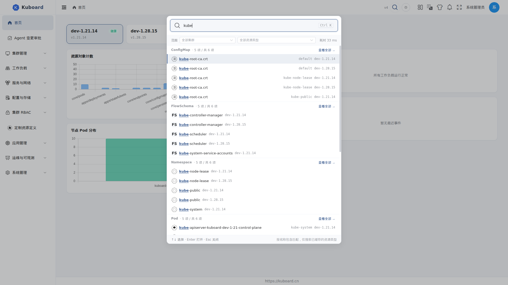

# 全局搜索

按 **Ctrl+K**（Mac 为 **⌘K**）或点击顶部工具栏的放大镜图标打开全局搜索，跨集群、跨资源类型按名称检索 Kubernetes 对象，输入关键词即可定位并跳转。

适用于需要频繁在多个集群、命名空间之间查找对象的运维与平台工程师；账号有可访问集群即可使用。

## 打开搜索

| 方式 | 操作 |
| --- | --- |
| 快捷键 | 按 **Ctrl+K**（Mac 为 **⌘K**）；在输入框、终端、编辑器等可编辑区域中不生效 |
| 图标 | 点击顶部工具栏右侧的放大镜图标 |
| 首次登录引导 | 登录后第一次打开（且账号有可访问集群）时，图标旁会弹出「试试全局搜索」气泡——点「试试看」直接打开搜索，点「知道了」后不再弹出 |

打开后浮层自上而下为：输入框 → 范围条（集群 / 资源类型）→ 结果区 → 操作提示条。

## 搜索范围

全局搜索按**名称包含**匹配（输入 `nginx` 可命中 `nginx-deploy`），并遵循以下边界：

| 边界 | 说明 |
| --- | --- |
| 集群 | 默认搜索当前账号有权访问的全部集群；可在范围条勾选指定集群 |
| 资源类型 | 默认搜索全部已缓存的资源类型；可在范围条勾选指定类型 |
| 权限 | 没有 list 权限的集群 / 资源类型会被自动跳过，不会出现在结果中 |

::: tip 为什么只搜索已缓存的资源类型
对象数据来自集群自动同步的缓存（见 [资源列表页](./object-list) 的「缓存与直查」）。未配置同步的资源类型不在搜索范围内；可在 **设置 → 系统设置 → 集群缓存设置** 的「缓存对象设置」中为资源类型开启缓存。
:::

默认已缓存并参与搜索的常见类型：Pod、Deployment、StatefulSet、DaemonSet、Namespace、Event、CRD 等。

## 使用步骤

1. 按 **Ctrl+K**（或点击放大镜）打开搜索浮层；
2. 输入关键词（最长 128 字符，输入停止约 0.2 秒后自动搜索）；
3. 如需缩小范围，在范围条右侧勾选**集群**或**资源类型**——不勾选 = 全部；选择会记忆，刷新页面后仍保留；
4. 结果按资源类型分组，每组标题为「Kind · 已显示 N 项 / 共 M 项」；命中数超过显示数时组尾出现「查看全部 →」，点击跳转到该类型的列表页；

5. 用 **↑ / ↓** 在结果间移动、**Enter** 打开选中的对象、**Esc** 关闭浮层，也可以直接点击结果行；
6. 点击结果按下表顺序定位对象：

| 落点 | 行为 |
| --- | --- |
| 详情页 | 有详情页的资源（如 Deployment、Pod）直接进入详情页 |
| 列表页 | 没有详情页的资源（如 Endpoints）进入该类型的列表页；组头标注「无详情页 · 打开为列表」 |
| 只读 YAML | 既没有详情页也没有列表页的资源，在浮层内以只读 YAML 打开 |
| 无法打开 | 当前账号没有读取权限时给出提示，不会跳转 |

## 最近访问

打开浮层且未输入关键词时，显示「最近访问」——点击过的对象会按账号记录在本地，点击即可再次跳转；没有历史记录时提示「输入关键词开始搜索」。

## 常见问题

**搜不到想要的对象？**

- 确认该资源类型已开启缓存（见「搜索范围」）——未缓存的类型不在搜索范围内；
- 确认当前账号对该集群、该类型有 list 权限；
- 全局搜索按名称包含匹配，不支持标签、注解、字段内容搜索；界面上的「包含标签搜索」「去高级搜索」为后续版本保留项；
- 关键词过长会被截断到 128 字符。

**结果为空但想扩大范围？**

点击结果区下方的「放宽到全部集群」，即可清空集群勾选，回到全部集群搜索。

**为什么结果行有时不标集群名？**

只选了 1 个集群时不重复标注；选多个集群或系统中有多个集群时，每条结果会标注所属集群。
