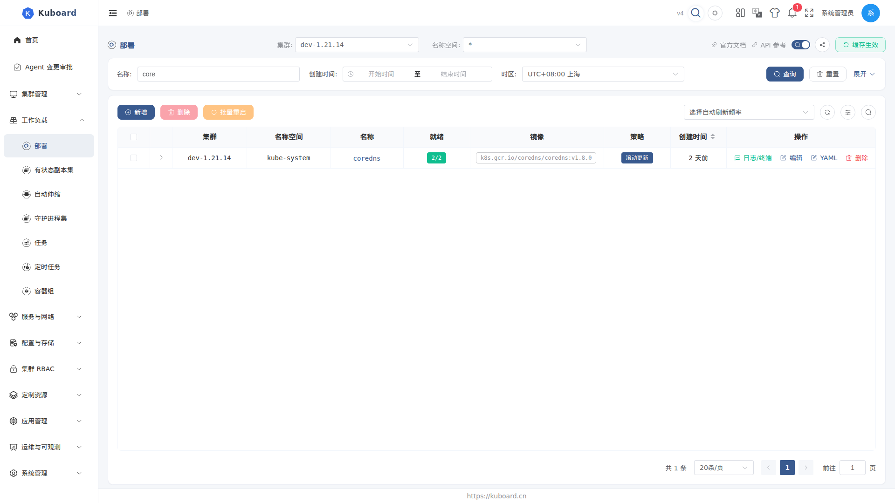

# 资源列表页

Kuboard 中所有 Kubernetes 资源（Deployment、Pod、ConfigMap、CRD 等）的列表页都遵循同一套页面结构，因此交互方式与操作一致。本页归纳这些共性；每个资源特有的字段与操作，见本指南对应章节（如 [Deployment](./../workload/deployments)）。

## 如何打开

从左侧菜单进入任意资源（例如 **工作负载 → Deployment**）即可打开列表页。页面从上到下依次为：

| 区域 | 内容 |
| --- | --- |
| 标题区 | 资源名称 + 指向 [Kubernetes 官方文档](https://kubernetes.io/docs) 的链接（概念说明 + API 参考） |
| 工具栏 | 列表模式开关、缓存状态、自动刷新、创建与批量操作按钮 |
| 数据区 | 集群/名称空间选择（搜索模式）或左侧资源树（树形模式）+ 资源表格 |

## 两种列表模式

列表页右上角的开关在 **搜索模式** 与 **树形模式** 之间切换（偏好会记忆，下次打开沿用）：

- **搜索模式**：页面顶部显示「集群」「名称空间」两个选择器。选定集群后，名称空间可选某个命名空间或「全部」，下方表格分页展示；
- **树形模式**：左侧显示 集群 → 名称空间 树（命名空间级资源）或 集群 树（集群级资源），点击节点即过滤列表。

::: tip 资源可用性提示
在树形模式下，若某个集群未安装当前资源（例如集群里没有安装 Gateway API），对应节点会显示 ⚠ 图标，悬停可查看安装引导。
:::

## 缓存与直查

列表数据来自两种通道，页面顶部以「使用缓存 / 没有缓存」标签标明当前资源的通道：

| 通道 | 说明 | 分页 |
| --- | --- | --- |
| **缓存列表** | 配置了自动同步的资源（如 Pod、Deployment、Namespace），列表读自 Kuboard 缓存，速度快 | 支持全集群搜索与分页 |
| **直查列表** | 未配置缓存的资源（多为低频资源与自定义资源）直接从集群 API 读取，数据实时 | 不能翻页（列表底部提示「未缓存的列表不能翻页」） |

## 通用列

所有列表页都包含以下通用列：

| 列 | 说明 |
| --- | --- |
| **名称** | 点击进入详情页（有查看权限时）；删除中的资源以删除线样式展示 |
| **名称空间** | 命名空间级资源显示所属名称空间 |
| **创建时间** | 按所选集群的时区显示 |
| **存活状态** | 存活 / 失效标记（部分资源） |
| **操作** | 编辑（有编辑页的资源）、查看 YAML、删除；资源特有的操作（如重启、伸缩）以额外按钮紧邻出现 |

## 通用操作

- **创建**：工具栏「添加」按钮，按资源类型走表单或 YAML 向导；
- **编辑 / 查看 YAML / 删除**：表格行内操作列；
- **批量操作**：勾选多行后执行，如批量删除——删除确认框会区分「Kubernetes 集群中的条目」与「缓存中的条目」并分别操作；工作负载等资源还支持批量重启等；
- **自动刷新**：工具栏的自动刷新按钮；在 URL 上追加 `?autoRefresh=true` 可在打开页面后自动开启。

## 筛选条件与地址栏同步

列表页的筛选条件（检索关键词、集群与名称空间选择、每页条数）会**同步到浏览器地址栏**：

- 调整筛选后，地址栏随之更新；清空的条件会从地址栏移除；
- 把地址栏链接复制给同事，对方打开后看到的是**同一批数据**；
- 从详情页返回列表页时，筛选条件仍然保留，不必重新选一遍。

地址栏上会出现的参数：

| 参数 | 含义 |
| --- | --- |
| `mode` | 列表模式：`search`（搜索模式）或 `tree`（树形模式） |
| `clusterId` / `namespace` | 搜索模式下选中的集群与名称空间 |
| `scopes` | 树形模式下选中的集群 / 命名空间节点 |
| `pageSize` | 每页条数 |
| 检索条件 | 按检索项分别出现（如名称关键词、创建时间范围），名称与表格中的检索框一一对应 |

::: tip 分享按钮
列表页与资源详情页的标题旁各有一个**分享**按钮，点击即复制当前地址栏链接（自动去掉「自动刷新」这类只影响自己的参数），复制成功有提示。不想手工拼链接时直接用它即可。
:::

## 权限控制

- 列表页每个按钮都按当前用户的 RBAC 权限自动显示 / 隐藏，无权限的操作不会出现；
- 若当前用户对整个集群没有该资源的 list 权限，页面顶部会提示「访问权限受限」，请在名称空间选择器中换用有权限的名称空间。