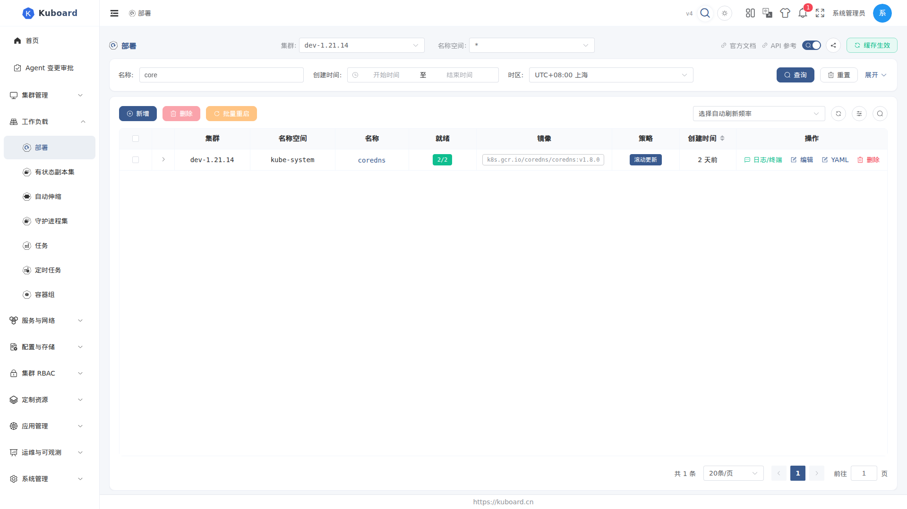

# 资源列表页

Kuboard 中所有 Kubernetes 资源（Deployment、Pod、ConfigMap、CRD 等）的列表页都遵循同一套页面结构，因此交互方式与操作一致。本页归纳这些共性；每个资源特有的字段与操作，见本指南对应章节（如 [Deployment](./../workload/deployments)）。

## 如何打开

从左侧菜单进入任意资源（例如 **工作负载 → Deployment**）即可打开列表页。页面从上到下依次为：

| 区域 | 内容 |
| --- | --- |
| 标题区 | 资源名称 + 指向 [Kubernetes 官方文档](https://kubernetes.io/docs) 的链接（概念说明 + API 参考） |
| 工具栏 | 范围模式（多范围 / 单范围）分段控件、缓存状态、自动刷新、创建与批量操作按钮、导出 CSV |
| 数据区 | 多范围模式：左侧资源树；单范围模式：集群 / 名称空间选择 + 资源表格 |

## 范围模式：多范围 / 单范围

工具栏上的 **范围模式** 是一组分段控件，用来决定「这一次要查哪些集群 / 名称空间」。切换后偏好会被记住，下次打开沿用（旧版本叫「树形模式 / 搜索模式」，能力与参数不变）：

| 模式 | 怎么选范围 | 适合场景 |
| --- | --- | --- |
| **多范围** | 左侧显示 集群 → 名称空间 树（命名空间级资源）或 集群 树（集群级资源），可**同时勾选多个**集群 / 名称空间；折叠后按钮上显示「范围 · N」 | 对比多个名称空间、跨集群排查 |
| **单范围** | 只查**一个集群内的一个名称空间**（名称空间可选「全部」）；筛选条件内嵌在页面上方的「筛选」卡片中 | 集群 / 名称空间很多、只关注一处；或列表页因请求过长打不开时的降级通道 |

::: tip 从多范围切到单范围
切换时取你已选范围中的**第一个**，并在顶部提示「已收窄为 `集群/名称空间`（原 N 项）」——不会静默丢掉你的选择，也不会替你决定保留哪几个。需要同时查看多个名称空间时，点「返回多范围」。
:::

::: tip 资源可用性提示
在多范围模式下，若某个集群未安装当前资源（例如集群里没有安装 Gateway API），对应节点会显示 ⚠ 图标，悬停可查看安装引导。
:::

## 缓存与直查

列表数据来自两种通道，页面顶部以「使用缓存 / 没有缓存」标签标明当前资源的通道：

| 通道 | 说明 | 分页 |
| --- | --- | --- |
| **缓存列表** | 配置了自动同步的资源（如 Pod、Deployment、Namespace），列表读自 Kuboard 缓存，速度快 | 支持全集群搜索与分页 |
| **直查列表** | 未配置缓存的资源（多为低频资源与自定义资源）直接从集群 API 读取，数据实时 | 不能翻页（列表底部提示「未缓存的列表不能翻页」） |

## 通用列

所有列表页都包含以下通用列：

| 列 | 说明 |
| --- | --- |
| **名称** | 点击进入详情页（有查看权限时）；删除中的资源以删除线样式展示 |
| **名称空间** | 命名空间级资源显示所属名称空间 |
| **创建时间** | 按所选集群的时区显示 |
| **存活状态** | 存活 / 失效标记（部分资源） |
| **操作** | 编辑（有编辑页的资源）、查看 YAML、删除；资源特有的操作（如重启、伸缩）以额外按钮紧邻出现 |

## 通用操作

- **创建**：工具栏「添加」按钮，按资源类型走表单或 YAML 向导；
- **编辑 / 查看 YAML / 删除**：表格行内操作列；
- **批量操作**：勾选多行后执行，如批量删除——删除确认框会区分「Kubernetes 集群中的条目」与「缓存中的条目」并分别操作；工作负载等资源还支持批量重启等；
- **自动刷新**：工具栏的自动刷新按钮；在 URL 上追加 `?autoRefresh=true` 可在打开页面后自动开启。

## 导出 CSV

列表页左侧动作按钮组末尾的 **导出 CSV** 按钮，把当前这份列表按你选的范围与列导出成 `.csv` 文件。

**导出范围**四选一：

| 范围 | 取数方式 | 说明 |
| --- | --- | --- |
| 已选 N 项 | 前端 | 只导出当前勾选的行；未勾选时不可选 |
| 当前页 N 行 | 前端 | 只导出当前页（每页条数由列表设置决定） |
| 当前筛选结果 | 服务端 | 按当前检索 / 高级筛选条件在服务端取全量结果，**不受分页限制** |
| 全部 | 服务端 | 当前范围内的全部数据，**忽略筛选条件** |

> 服务端导出首版只覆盖 **节点（nodes）/ 容器组（pods）/ 工作负载（deployments）** 三类；其它资源在「当前筛选结果 / 全部」上会提示「后续版本提供」，可改用「已选 / 当前页」。

**导出列**：对话框里可勾选要导出的列（默认全选）。选择 / 展开 / 序号 / 单选框 / 操作这类结构列不参与导出，会提示「N 列仅界面展示」；列取值与表格同源，不同范围下看到的列完全一致。

**格式与上限**：

- UTF-8 with BOM、RFC 4180 转义（含逗号 / 引号 / 换行 / 中文字段在 Excel 中可直接打开）；数值不带单位后缀；
- 单次上限 **10000 行**：结果超出时对话框提示「结果约 N 行，只会导出前 10000 行」，需勾选「我已了解只会导出前 10000 行」后才能继续——不会静默截断，也不会产出半截文件。

**权限与审计**：

- 导出按你当前的 RBAC 权限取数：越权范围会被**跳过**而不是整单失败，响应头 `X-Kuboard-Skipped-Scopes` 里是跳过的范围数量；
- 一个可用范围都没有时返回 403（JSON 错误体），而不是给你一个空文件；
- 每次导出都会写入审计事件，可在「审计」页按资源查看。

::: tip 导出与筛选同源
导出「当前筛选结果」时，行数与列表上「共 N 条（已筛选）」的提示一致；导出动作本身不会改变你的筛选条件或勾选状态。
:::

## 筛选条件与地址栏同步

列表页的筛选条件（检索关键词、集群与名称空间选择、每页条数）会**同步到浏览器地址栏**：

- 调整筛选后，地址栏随之更新；清空的条件会从地址栏移除；
- 把地址栏链接复制给同事，对方打开后看到的是**同一批数据**；
- 从详情页返回列表页时，筛选条件仍然保留，不必重新选一遍。

地址栏上会出现的参数：

| 参数 | 含义 |
| --- | --- |
| `mode` | 范围模式：`search`（单范围）或 `tree`（多范围）；旧链接里的取值仍然可用 |
| `clusterId` / `namespace` | 单范围模式下选中的集群与名称空间 |
| `scopes` | 多范围模式下选中的集群 / 命名空间节点 |
| `pageSize` | 每页条数 |
| 检索条件 | 按检索项分别出现（如名称关键词、创建时间范围），名称与表格中的检索框一一对应 |

::: tip 分享按钮
列表页与资源详情页的标题旁各有一个**分享**按钮，点击即复制当前地址栏链接（自动去掉「自动刷新」这类只影响自己的参数），复制成功有提示。不想手工拼链接时直接用它即可。
:::

## 权限控制

- 列表页每个按钮都按当前用户的 RBAC 权限自动显示 / 隐藏，无权限的操作不会出现；
- 若当前用户对整个集群没有该资源的 list 权限，页面顶部会提示「访问权限受限」，请在名称空间选择器中换用有权限的名称空间。