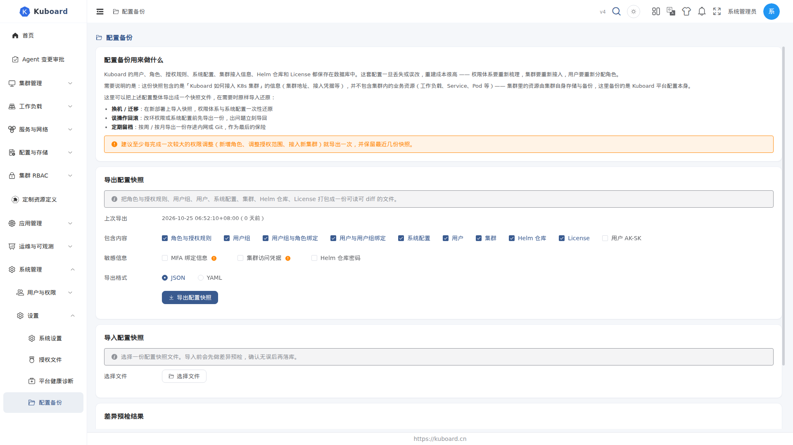
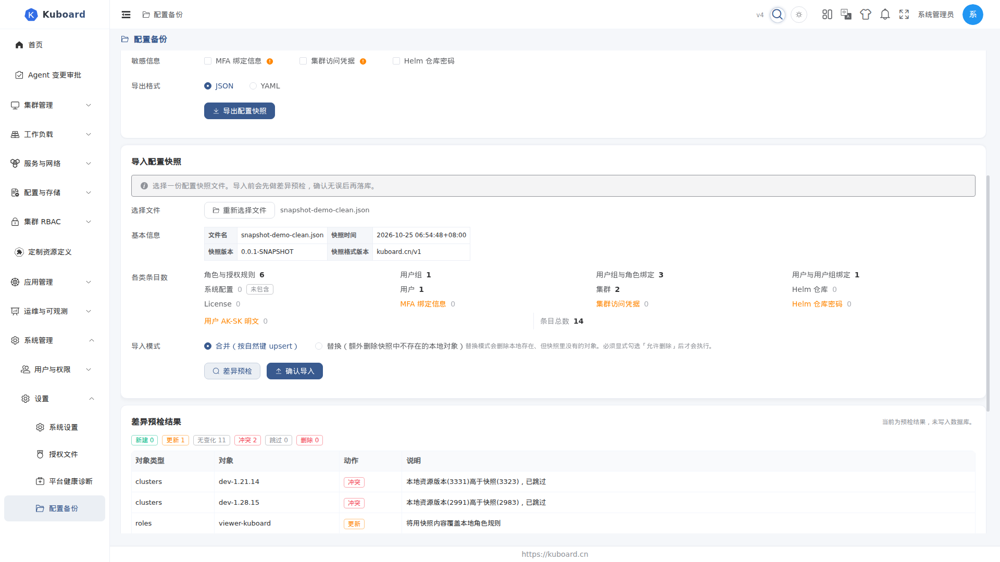

# 配置备份

在 **系统管理 → 设置 → 配置备份** 打开页面，把 Kuboard 的用户、角色、授权规则、系统配置、集群接入信息、Helm 仓库、License 整体导出成一份快照文件，需要时原样导入还原。

适用于 Kuboard 管理员：**换机 / 迁移**、**误操作回滚**、**定期留档**。快照只包含 Kuboard 平台自身的配置，不包含集群内的业务资源（工作负载、Service、Pod 等）。

## 打开页面

1. 登录后进入 **系统管理 → 设置 → 配置备份**；
2. 导出需要 `config.kuboard.cn / backup` 的 **list** 权限，导入需要 **create** 权限（管理员默认具备；只读角色只能导出）；
3. 该菜单项可在 **设置 → 系统设置 → 菜单项设置** 中禁用；禁用后待办提醒会引导去「菜单项设置」恢复。

## 导出配置快照

1. 查看「上次导出」：显示最近一次导出的时间与距今天数；从未导出过会提示「从未导出过配置快照」。
2. 勾选「包含内容」：默认选中角色与授权规则、用户组、用户组与角色绑定、用户与用户组绑定、用户、集群、Helm 仓库、License、系统配置 9 类；「用户 AK-SK」默认不选，需要时手动勾选。
3. 勾选「敏感信息」（默认全部不选，每项带警示说明）：
   - **MFA 绑定信息**：含 TOTP 种子（明文）与恢复码，持有该文件的人可生成对应用户的一次性验证码；
   - **集群访问凭据**：含集群的 kubeconfig / token（明文）；
   - **Helm 仓库密码**。
4. 选择「导出格式」：JSON（默认）或 YAML。
5. 点击 **导出配置快照** → 浏览器下载 `kuboard-config-snapshot-<时间>.json`（或 `.yaml`）文件。

建议至少每完成一次较大的权限调整（新增角色、调整授权范围、接入新集群）就导出一次，并保留最近几份快照。

::: tip 快照不含集群资源
快照包含的是「Kuboard 如何接入 K8s 集群」的信息（集群地址、接入凭据等），不包含集群内的业务资源。集群内资源由集群自身存储与备份。
:::

## 导入配置快照

1. 点击 **选择文件**，选一份快照文件（支持 `.json` / `.yaml` / `.yml`）。
2. 确认「基本信息」与「各类条目数」：文件解析后展示快照时间、来源 Kuboard 版本、快照格式版本与各类对象条数；快照里没有的数据类标注「未包含」，含敏感字段的项打「敏感」标签。
3. 选择「导入模式」：
   - **合并**：按对象名逐条比对，本地已有的更新、没有的新建（默认）；
   - **替换**：在合并基础上，额外删除本地存在、但快照里没有的对象；需勾选「允许删除本地多余对象」才会执行。
4. 点击 **差异预检** → 列出逐条差异（新建 / 更新 / 无变化 / 冲突 / 跳过 / 删除）。预检**不写入数据库**。
5. 存在冲突或选择了替换模式时，二次确认（列出将被删除 / 冲突的条目）后点击 **确认导入**。

导入完成后提示「配置导入完成」；权限、菜单、集群、AK 缓存会自动失效，**无需重启后端**。若权限仍未生效，可到「平台健康诊断」页手动清理缓存。

## 敏感信息与安全

| 项 | 默认 | 说明 |
| --- | --- | --- |
| JWT 私钥、OIDC 加密密钥 | 永远不导出 | 每次部署独立生成，导出无意义 |
| 登录共享密钥、OIDC 客户端密钥 | 掩码 | 快照中以占位符出现，导入时保留本地当前值 |
| MFA 绑定信息（TOTP 种子 / 恢复码 / 应急码） | 不导出 | 需显式勾选；导出后持有文件者即可生成对应用户的验证码 |
| 集群访问凭据（kubeconfig / token） | 不导出 | 需显式勾选 |
| Helm 仓库密码 | 不导出 | 需显式勾选 |
| 用户 AK-SK | 不导出 | 需显式勾选 |

开启敏感项导出后，请妥善保管快照文件（泄漏等于凭据泄漏）。快照为 KB 级，可安全放进 git / 网盘 / 内网存储。

::: warning 恢复集群需重新接入凭据
未包含集群凭据的快照导入后，对应集群处于「无凭据」状态：导入报告会列出这些集群，需到「集群管理」重新接入 kubeconfig / token 并等待一轮同步。
:::

## 备份提醒

为防止「从来不知道要备份」，Kuboard 提供两条提醒通道：

| 通道 | 位置 | 触发 |
| --- | --- | --- |
| 待办提醒（主） | 顶部消息中心「待办」页签 + 角标 | 距上次导出超过提醒周期时出现；点「知道了」静音，静音期为当前时间 + 提醒周期 |
| 健康诊断 finding（辅） | 「平台健康诊断」页「问题检测」区 | 超过严重阈值后报出「配置长时间未备份」 |

提醒策略在 **系统管理 → 设置 → 系统设置 → 配置备份** 页签配置：

| 配置项 | 默认 | 说明 |
| --- | --- | --- |
| 启用备份提醒 | 开 | 总开关；关闭后既不出现待办，也不产生健康诊断 finding |
| 提醒周期（天） | 7 | 距上次导出超过该天数，在消息中心提醒 |
| 严重阈值（天） | 30 | 超过该天数未导出的，健康诊断 finding 升级为「严重」 |

「上次导出时间」取自每次在配置备份页成功生成快照的时刻；从未导出过视为已超期，会立即提醒。

::: tip 提醒范围
提醒面向所有具备导出权限的用户，与用户来源无关；静音只影响当前用户，不影响其他管理员。
:::

## 常见问题

| 症状 | 处理 |
| --- | --- |
| 导入后权限没变化 | 缓存已自动失效；仍未生效时到「平台健康诊断」点「清理缓存」（授权），当前登录用户的菜单与权限立即重建 |
| 恢复的集群不在列表 / 数据不更新 | 快照未包含集群凭据时，到「集群管理」重新接入凭据，等待一轮同步 |
| 担心误删本地对象 | 替换模式只有勾选「允许删除本地多余对象」且二次确认才执行删除；恢复前先做差异预检，确认「将被删除」清单 |
| 导入报「快照格式版本不符」 | 快照格式版本与当前版本不兼容（导入前会强校验），请用同版本的快照导入 |
| 找不到「配置备份」菜单 | 可能已在「菜单项设置」中被禁用，到 **系统管理 → 设置 → 菜单项设置** 恢复 |

本节涉及的接口属于 `config.kuboard.cn` 分组（系统配置接口），接口说明见 [接口文档总览](../reference/api)。
