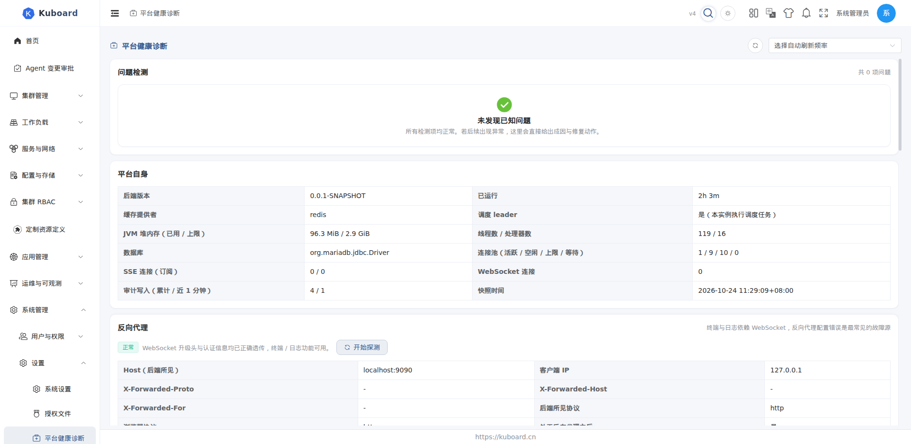

# 平台健康诊断

在 **设置 → 平台健康诊断** 打开诊断页，平台把散落在各处的运行事实（缓存、集群同步、License、数据库连接池、反向代理）聚合成一屏快照：有问题直接给出成因与一键修复动作，无需先导日志、翻配置。

适用于 Kuboard 管理员排障：刚升级完、改了菜单 / 权限不生效、列表数据陈旧、终端打不开等场景，都可以先到这里看结论。

## 打开页面

1. 登录后进入 **设置 → 平台健康诊断**；
2. 页面需要 `health.kuboard.cn / diagnostics` 的 **list** 权限（管理员默认具备）；
3. 该菜单项可在 **设置 → 系统设置 → 菜单项设置** 中禁用（关闭后不再出现在左侧菜单）。

打开后从上到下依次为：**问题检测 → 平台自身 → 反向代理 → 集群 → 缓存资源 → 常见问题**。

## 问题检测

平台按以下维度自动判定问题，并按严重程度排序（**严重 > 警告 > 提示**）：

| 检测维度 | 判定的问题示例 |
| --- | --- |
| 菜单缓存 | 菜单定义已变更但缓存未刷新、菜单缓存过旧（超过 24 小时） |
| 授权缓存 | 角色 / 用户组有变更但授权缓存未失效（「改了权限不生效」） |
| 集群缓存与同步 | 缓存健康异常、同步任务失败、增量同步（watch）疑似中断、全量同步偏慢 |
| License | 已过期、即将过期（30 天内）、可用集群额度不足（License 份数 + 每套免费 3 个） |
| 数据库连接池 | 活跃连接接近上限、等待线程堆积 |
| 反向代理 | WebSocket 升级头丢失、握手被拒、`X-Forwarded-Proto` 缺失、Host 被改写、浏览器探测未通过 |

全部正常时显示「未发现已知问题」。

每个问题条目显示：严重级别、标题、证据（发生时间 / 集群 / 资源等）与修复按钮。点击修复按钮立即执行，**无需重启后端**。

## 一键修复

| 动作 | 效果 |
| --- | --- |
| 清理缓存 | 清理菜单缓存或授权缓存；「清理全部缓存」还会清系统配置、资源类型映射等缓存 |
| 重启全量同步 | 对该集群重建全部缓存对象的同步任务 |
| 检测连通性 | 校验该集群 apiserver 连通性（导入参数是否正确、网络是否可达） |

::: tip 多实例部署
缓存默认存放在单实例本地，清理缓存只影响当前实例；设置 `KUBOARD_CACHE_PROVIDER=redis` 后使用共享缓存，清理对所有实例生效。
:::

## 平台自身

| 指标 | 说明 |
| --- | --- |
| 后端版本 / 已运行 | 版本号、启动至今时长 |
| 缓存提供者 / 调度 leader | 缓存实现（本地 / redis）、当前实例是否是调度 leader |
| JVM 堆 / 线程 | 堆内存已用与上限、线程数与处理器数 |
| SSE / WebSocket 连接 | 本实例的连接数 |
| 审计写入 | 累计写入条数 / 近 1 分钟条数 |
| 数据库连接池 | 活跃 / 空闲 / 上限 / 等待 |
| 快照时间 | 本次快照的生成时间 |

::: tip 连接数说明
SSE 与 WebSocket 连接由进程持有，多副本部署时本页显示的是**当前实例**的数字，各实例需分别查看。
:::

## 反向代理

终端 / 日志依赖 WebSocket，反向代理配错是最常见的故障源。本区块回答「这条链路断在哪一环」：

**浏览器探测**：点击「开始探测」，从你当前浏览器发起，沿「浏览器 → 反向代理 → Kuboard」链路分三步检查：

| 步骤 | 检查内容 |
| --- | --- |
| 1. 可达性 | 请求有没有到达 Kuboard 后端 |
| 2. 升级头透传 | WebSocket 升级头（Upgrade / Connection）是否被代理转发 |
| 3. 认证透传 | 认证信息（access_token）是否到达后端 |

探测结论四类：**正常**、**升级头未透传**、**路径未路由**、**认证信息未透传**、**空闲超时过短**。每类结论都给出对应原因与修复提示。

**服务端观测**：后端统计「升级头丢失」与「握手被拒」的次数与最近发生时间（本实例计数），可与代理日志、抓包结果对照。

修复指引见区块内的「如何修复」，提供 [Nginx / Ingress 官方配置样例](../install/reverse-proxy)。

::: tip 探测链路范围
探测反映「当前浏览器 → 当前代理 → Kuboard」这一条链路；多入口 / 多代理部署时需分别验证。
:::

## 集群

每个集群一行，显示 K8s 版本、缓存健康、导入状态、同步异常、缓存对象数、最近全量同步与 apiserver 地址；操作列提供「重启全量同步」与「检测连通性」。

## 缓存资源

列出每种资源类型的同步方式（**监听 / 轮询 / 无缓存**）、轮询间隔、全量 / 增量同步状态与 watch 心跳。无缓存的资源不自动同步，列表数据直接查集群（见 [资源列表页](../guide/ui/object-list) 的「缓存与直查」）。

## 常见问题

| 症状 | 处理 |
| --- | --- |
| 左侧「定制资源」下没有新装的 CRD | 先看「问题检测」是否有集群缓存不健康 / 同步失败，点「重启全量同步」后刷新 |
| 改了角色权限，用户侧没变化 | 在本页点「清理缓存」（授权），当前用户的菜单与权限立即重建 |
| 列表页数据很久没变 | 对该集群「重启全量同步」；apiserver 不可达时先「检测连通性」 |
| 整个平台响应变慢 | 看「平台自身」的连接池数字；连接池饱和时重启全量同步通常立刻缓解 |
| Pod 终端打不开、日志看不到 | 在「反向代理」点「开始探测」确认断在哪一环，再修正代理配置 |

本节涉及的接口（`health.kuboard.cn`）不在 Swagger UI 的既有分组中列出；接口说明见 [接口文档总览](../reference/api)。