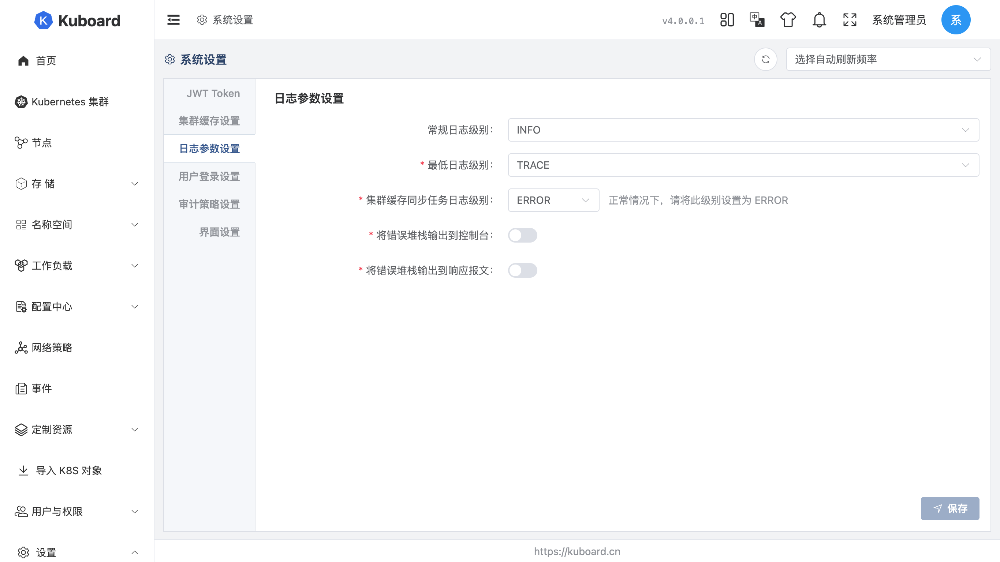

# Kuboard v4 环境变量

部署 Kuboard v4 时，可配置的环境变量包括数据库连接、缓存、时区与端口。下文按用途列出全部变量及默认值。

::: tip 在哪里设置
这些环境变量写在部署 Kuboard 的 `docker-compose.yaml` 或 Kubernetes Deployment 的 `env` 字段中，部署步骤见 [快速开始](../install/quickstart)。
:::

所有变量均可省略，未设置时使用下表默认值；只有多副本（高可用）部署才需要配置 `KUBOARD_CACHE_*` 缓存变量。

## 数据库连接参数

| 环境变量 | 默认值 | 说明 |
| --- | --- | --- |
| `DB_DRIVER` | `com.mysql.cj.jdbc.Driver` | 数据库驱动，按所连数据库选择，见下方示例 |
| `DB_URL` | `jdbc:mysql://localhost:3306/kuboard` | 数据库连接串，按所选数据库编写，见下方示例 |
| `DB_USERNAME` | `kuboard` | 数据库用户名 |
| `DB_PASSWORD` | `Kuboard123` | 数据库密码 |

`DB_DRIVER` 与 `DB_URL` 按数据库类型填写：

- MySQL：驱动 `com.mysql.cj.jdbc.Driver`，连接串 `jdbc:mysql://10.99.0.8:3306/kuboard?serverTimezone=Asia/Shanghai`
- MariaDB：驱动 `org.mariadb.jdbc.Driver`，连接串 `jdbc:mariadb://10.99.0.8:3306/kuboard?&timezone=Asia/Shanghai`
- OpenGauss：驱动 `org.postgresql.Driver`，连接串 `jdbc:postgresql://localhost:5432/kuboard?currentSchema=kuboard&characterEncoding=UTF8`

### 连接池参数

同步任务写库与全部 HTTP 请求共用同一个连接池，连接不够时请求会排队等待。连接池默认按中等规模集群取值，一般无需修改；集群数量多、对象量大（例如单集群十几万容器组）或数据库侧出现过「拿不到连接」时再调大。

| 环境变量 | 默认值 | 说明 |
| --- | --- | --- |
| `DB_POOL_MAX_SIZE` | `32` | 连接池最大连接数。大量同步写入时若被占满，连调度线程自己也会拿不到连接，可适当调大 |
| `DB_POOL_MIN_IDLE` | `8` | 最小空闲连接数，池中保持的空闲连接 |
| `DB_POOL_CONNECTION_TIMEOUT_MS` | `30000` | 从池中获取连接的最长等待（毫秒），超时即报错，避免线程无限堆积 |
| `DB_POOL_IDLE_TIMEOUT_MS` | `600000` | 连接空闲多久后被回收（毫秒，默认 10 分钟）。批量写库期间连接会一直被借用，不宜设得过短 |
| `DB_POOL_MAX_LIFETIME_MS` | `1800000` | 连接的最长存活时间（毫秒，默认 30 分钟） |

::: tip 连接数怎么估算
多副本部署时，所有实例的连接数之和不能超过数据库的最大连接数：保证「**实例数 × `DB_POOL_MAX_SIZE`**」小于数据库的 `max_connections`，并为运维工具留出余量。例如数据库上限 500、副本 3 个时，每个实例设 100 以内比较稳妥。
:::

## 高可用缓存参数

单副本部署无需配置本组变量；多副本（高可用）部署时，将 `KUBOARD_CACHE_PROVIDER` 设为 `redis`，并填写下方 Redis 连接信息。

| 环境变量 | 默认值 | 说明 |
| --- | --- | --- |
| `KUBOARD_CACHE_PROVIDER` | `caffeine` | 缓存提供方式：`caffeine` 内存缓存（仅单副本模式），`redis` 分布式缓存（多副本高可用） |
| `KUBOARD_CACHE_REDIS_MODE` | `standalone` | Redis 连接模式：`standalone`、`sentinel` 或 `cluster` |
| `KUBOARD_CACHE_REDIS_NODES` | `localhost:6379` | Redis 节点地址，多节点用逗号分隔，各模式示例见下方 |
| `KUBOARD_CACHE_REDIS_SENTINEL_MASTER` | `master` | Sentinel 模式下的 master 名称 |
| `KUBOARD_CACHE_REDIS_USERNAME` | 空 | Redis 6+ ACL 用户名，留空表示使用 `default` 用户（仅 `AUTH <password>`） |
| `KUBOARD_CACHE_REDIS_PASSWORD` | 空 | 连接 Redis 的密码 |
| `KUBOARD_CACHE_REDIS_DATABASE` | `0` | Redis 数据库编号 |
| `KUBOARD_CACHE_REDIS_KEY_PREFIX` | 空 | Redis key 的部署级前缀。多套 Kuboard 共用同一个 Redis database 时必须设置（如 `prod` / `staging`），只允许字母、数字、`.`、`_`、`-`，详见下方说明 |

`KUBOARD_CACHE_REDIS_NODES` 各模式写法示例：

- `standalone`：`10.99.0.8:6379`
- `sentinel`：`10.99.0.10:6379,10.99.0.11:6379,10.99.0.12:6379`
- `cluster`：`10.99.0.20:6379,10.99.0.21:6379,10.99.0.22:6379`

### 多套 Kuboard 共用同一个 Redis

Kuboard 写入 Redis 的 key 都带一个**部署级前缀**（环境变量 `KUBOARD_CACHE_REDIS_KEY_PREFIX`），覆盖共享缓存（菜单 / 权限 / 系统配置等）、调度 leader 租约、SnowFlake 槽位、JWT 黑名单、OIDC 登录 state、日志缓冲、MCP 会话与限流，以及全部 Pub/Sub 通道。

单套部署**留空即可** —— 空前缀时 key 与升级前完全一致，升级不会清缓存、不会重新选举调度 leader、不会中断 SSE 订阅。

**什么时候必须设置**：同一个 Redis database 上运行了两套及以上 Kuboard（生产 + 测试、两个租户、同一台机器上的多套编排）。不隔离会互相干扰：

- 只有一套能拿到调度 leader 租约，另一套的同步调度 / 健康巡检 / 审计建表全部停摆；
- 菜单 / 权限 / 系统配置缓存互相覆盖（表现为「权限串台」）；
- 页面事件（SSE）互相投递。

**怎么设置**（二选一，优先用前缀）：

```yaml
environment:
  - KUBOARD_CACHE_REDIS_KEY_PREFIX=prod # 只允许 A-Z a-z 0-9 . _ -
  # 或：- KUBOARD_CACHE_REDIS_DATABASE=3 # 仅 standalone / sentinel 模式有效，cluster 模式忽略
```

- 前缀只允许字母、数字、`.`、`_`、`-`；含冒号或花括号的取值会被忽略并在启动日志中告警（避免改变 Redis Cluster 的 slot 计算）；
- 同一套部署的**所有副本必须使用同一个值**；
- 设置前缀后，Redis ACL 授权的 key / 通道前缀也要相应带上该前缀。

**切换前缀 = 一次全量重启**：旧前缀下的缓存、租约与通道对新前缀不可见。滚动升级（`maxSurge ≥ 1`）期间新旧前缀会并存，最长 120 秒（一个 leader 租约的 TTL）内**存在两套调度 leader**。变更说明里应写「停全部副本 → 改前缀 → 一起启动」，而不是滚动更新。

**前缀也可当作「缓存值版本」**：Redis 中缓存的值是带类型标记的 JSON，跨大版本升级时若缓存结构发生变化，把前缀改成带版本号的值（如 `prod-v435`）即可让旧值自然不可见，不需要手工执行 `FLUSHDB`。即便不换前缀，读到无法反序列化的旧值时 Kuboard 也会自动清理该缓存条目并回源重新加载，不会导致启动失败。

**如何确认生效**：

- 启动日志会打印 `Redis key prefix = '<prefix>'`；未设置时是一条告警日志（提示多套部署共用同一 Redis 的风险）；
- [平台健康诊断](../ops/health-diagnostics) 在使用共享 Redis 且未设置前缀时给出「Redis key 未设置部署前缀」的提示（提示级，不影响健康评分）；
- 运维自查：

```sh
# 未设置前缀时：调度 leader 租约应只有一条
redis-cli --scan --pattern 'kbd:scheduler:leader'
# 设置前缀后（示例 prefix=prod）
redis-cli --scan --pattern 'prod:*'
```

::: tip 较新引入的 key 有自己的默认前缀
浏览器侧探测结果（反向代理探测、请求长度探测）在未配置前缀时使用 `kbd` 作为前缀（如 `kbd:probe:proxy`）；配置了前缀则与其它 key 一致带该前缀。
:::

## 其他参数

| 环境变量 | 默认值 | 说明 |
| --- | --- | --- |
| `TZ` | `Asia/Shanghai` | Kuboard 使用的时区 |
| `SERVER_PORT` | `80` | 容器内服务端口；本地源码运行默认 `9090`，生产环境对外端口由 docker / nginx 决定（默认暴露 `80`） |
| `KUBOARD_SWAGGER_ENABLED` | `true` | 是否开启 Swagger UI 接口文档，设为 `false` 可关闭（访问方式见 [OpenAPI 接口文档](./api)） |
| `KUBOARD_SPRING_BOOT_ADMIN_ENABLED` | `false` | 是否启用 Spring Boot Admin 监控页面 |
| `SERVER_MGMT_PORT` | `9091` | Spring Boot 管理端点端口，一般无需修改 |
| `KUBOARD_DDL_LOCK_TIMEOUT_SECONDS` | `300` | DDL 跨实例互斥锁的等待上限（秒）。多副本高可用同时启动时，只有拿到数据库级锁的实例执行 DDL，其余实例等待；超过该时长即启动失败（fail-fast）。表体量大时升级脚本耗时长，可酌情调大 |
| `KUBOARD_MAX_HTTP_REQUEST_HEADER_SIZE` | `32KB` | 单次 HTTP 请求行 + 请求头的解析上限。资源列表页多选命名空间时浏览器会自动附加含完整页面 URL 的 `Referer`，命名空间较多时默认值会被撑破（HTTP 400）；按实际命名空间规模调整，且前置 Nginx / 网关 / 云 LB 的请求头长度限制需同步放宽 |

## 排障

遇到启动失败、接口报错、数据不同步等问题时，按本节约三种方式排查：查看日志输出位置、调整日志级别、按请求 ID 定位单次请求。

### 日志输出位置

Kuboard 日志输出到两个位置：

| 位置 | 说明 |
| --- | --- |
| 控制台（全量日志） | `docker logs kuboard` 查看已有日志；`docker logs -f kuboard` 持续跟踪 |
| 宿主目录 `kuboard-log/<主机名>/`（容器内 `/app/logs/<主机名>/`） | 按模块分文件，见下表 |

| 文件 | 内容 |
| --- | --- |
| `api/kuboard-log.log` | 接口调用日志 |
| `audit/kuboard-audit.log` | 审计日志（需在 设置 → 系统设置 启用） |
| `sync/<集群ID>.log` | 集群缓存同步日志 |
| `health.log` | 集群连接状态日志 |
| `main.log` | 启动日志 |

### 设置日志级别

在 Kuboard 界面 **设置 → 系统设置 → 日志参数设置** 中调整日志级别，界面见下图：



### 按请求 ID 定位单次请求日志

生产环境日志量大，难以快速定位单个请求时，可为单个请求单独提高日志级别：请求报文头加 `kb-log-level`（可选 `ERROR`/`WARN`/`INFO`/`DEBUG`/`TRACE`），响应报文头返回 `kb-request-id`，用该 ID 过滤出本次请求的全部日志：

```sh
curl -v 'http://<kuboard 地址>/api/cluster.kuboard.cn/v4/cluster?pageNum=1&pageSize=20' \
  -H 'kb-log-level: TRACE'
```
响应报文头中的 `kb-request-id`（示例 `1qZPF6iNMvC`）即本次请求的日志标识，按该 ID 过滤日志：
```sh
docker logs kuboard | grep 1qZPF6iNMvC
```
::: tip 容器组日志界面
容器组日志查看界面与命令行终端界面也支持临时调整日志级别，在 URL 上添加请求参数 `kb_log_level`（取值同上）。
:::
日志相关配置（审计开关等）见 [审计日志](../ops/audit-log)。
