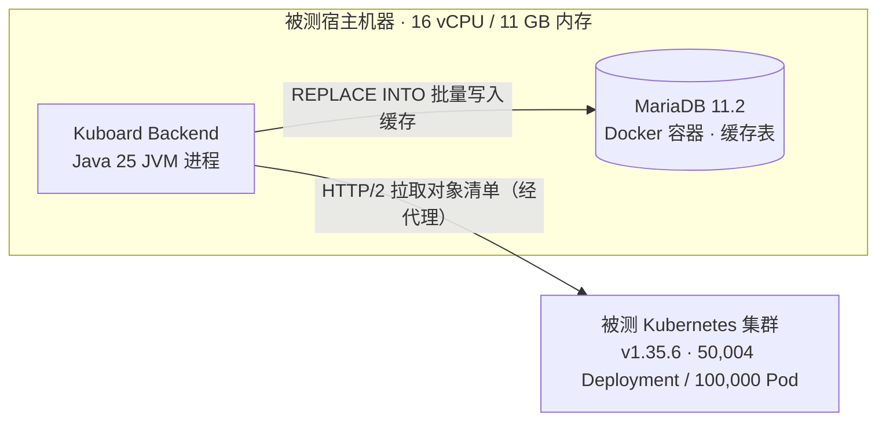
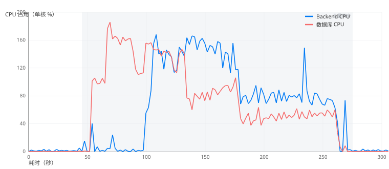
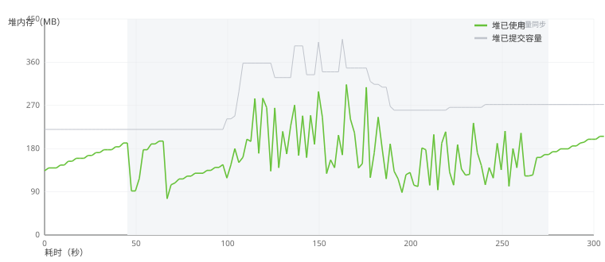
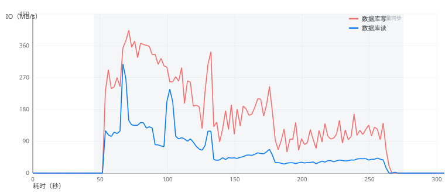
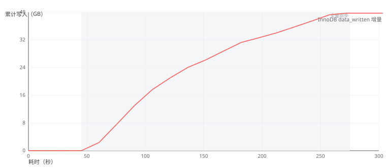
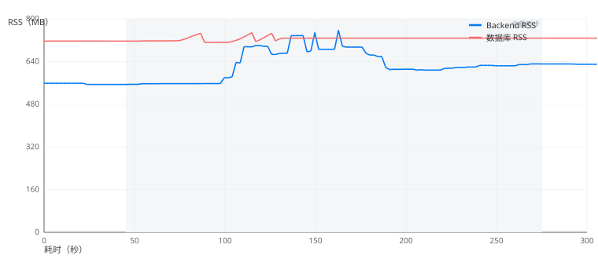
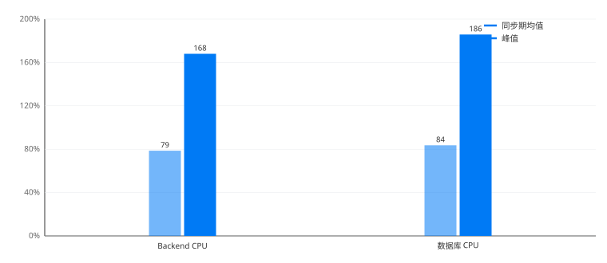
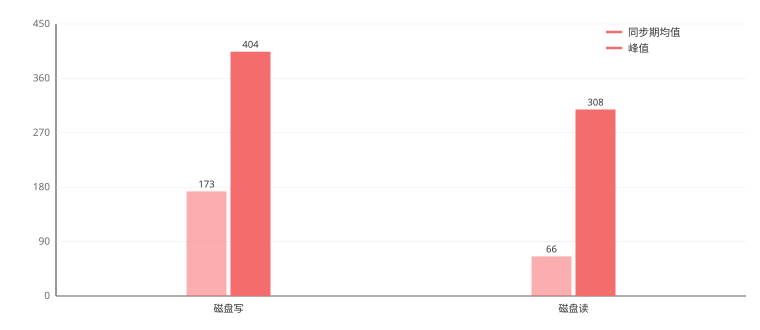

# 大规模集群全量同步性能基准

本页给出 Kuboard V4 在超大规模集群下执行「重启全量同步」的实测数据，包括**总耗时**与 **Backend / 数据库资源消耗曲线**，供部署规模评估与容量规划时参考。

适用读者：集群运维 / 管理员、容量规划人员。同步机制的说明见[集群状态同步与缓存](../guide/cluster/sync-status)。

## 测试环境与规模

| 项目 | 值 |
| --- | --- |
| Kubernetes 集群 | 测试集群，v1.35.6 |
| 对象规模 | **Deployment 50,004 个、Pod 100,000 个**（缓存行合计 150,152） |
| Kuboard backend | 单实例；**进程实际占用**：RSS 基线约 556 MB → 同步峰值约 757 MB，JVM 堆峰值约 313 MB，CPU 峰值约 168%（≈1.7 核） |
| 数据库 | MariaDB 11.2（容器）；**进程实际占用**：RSS 基线约 716 MB → 峰值约 748 MB，CPU 峰值约 186%（≈1.9 核）；缓存落于 `kb_cluster_sync_data` |
| 部署形态 | backend 与数据库运行于**同一台宿主**（16 核 / 11 GB 内存）上；本页资源数据均为进程 / 容器实际占用，不包含宿主整机配置 |
| 同步任务数 | 32 个资源任务（除主任务外） |

::: tip 什么是 RSS
**RSS（Resident Set Size，常驻内存集）** 指进程当前实际占用的**物理内存**大小（单位 MB），是衡量进程内存占用最直观的指标。它不包含已换出到磁盘的页，也远小于进程的虚拟内存（VSZ）。本页所有「RSS」数值均为实测的进程常驻内存：Backend 对应 Java 进程，数据库对应容器内的 `mariadbd` 进程。
:::

## 部署拓扑与机器配置

### 部署拓扑

被测系统为 **Kuboard Backend + MariaDB 数据库同机部署**：两者共用一台 16 vCPU / 11 GB 内存的宿主机器。Backend 以 Java JVM 进程运行（spring-boot 单实例，开发模式），数据库以 Docker 容器运行。同步时 Backend 通过 HTTP/2（经代理）从被测 Kubernetes 集群拉取对象清单，解析后以 `REPLACE INTO` 批量语句写入数据库缓存表。

::: tip 同机部署的意义
Backend 与数据库共享宿主机器的 CPU 与内存，因此本页数据使用**进程 / 容器的实际占用**（而非宿主整机配置）来度量资源消耗，可直接用于评估生产部署时单机所需的资源。
:::

### 机器基本配置

| 项目 | 配置 |
| --- | --- |
| 操作系统 | Ubuntu 24.04.5 LTS（内核 6.8.0-146-generic） |
| CPU | 16 vCPU（Intel Core i5-14400，云虚拟化环境） |
| 内存 | 11 GB（测试期间可用约 5 GB） |
| 磁盘 | **240 GB SSD 固态硬盘**（云虚拟机 virtio 虚拟磁盘；LVM 根分区 234 GB，测试时已用约 49%） |
| Kuboard backend | Java 25 JVM 进程（spring-boot 单实例，无 CPU / 内存限制） |
| 数据库 | MariaDB 11.2 容器（无 CPU / 内存限制） |

::: warning 测量环境说明
测试期间该宿主上还运行着 Redis、本地 kind 测试集群等容器（处于空闲状态），对测量无实质影响；被测 `k8s-135` 为远程集群，Backend 通过代理访问其 API Server。若生产环境存在其它负载，实际资源消耗可能高于本页数据。
:::

## 测试方法与采集手段

- **操作**：调用「重启全量同步」接口 `POST /api/cluster.kuboard.cn/v4/cluster/{uid}/restart-full-sync`。触发后调度器重新发现集群 `/apis`、重建各资源的同步任务，并逐个执行全量刷新。
- **耗时口径**：以 `kb_cluster_sync_task` 中各资源任务的 `full_sync_start_time / full_sync_end_time` 为准。
- **Backend 采样**：`/proc` 读取进程 CPU / RSS，`jstat` 读取 JVM 堆与 GC，2 秒粒度。
- **数据库采样**：`/proc` 读取 CPU / RSS，cgroup `io.stat` 读取容器磁盘 IO，`information_schema.GLOBAL_STATUS` 读取 InnoDB 计数器。

## 全量同步耗时

| 指标 | 结果 |
| --- | --- |
| **触发 → 全部任务完成** | **约 214 秒**（3 分 34 秒） |
| `deployments` | 125.0 秒，50,004 对象（约 400 对象/秒） |
| `pods` | **208.9 秒**，100,000 对象（约 479 对象/秒） |
| 其余 30 个资源 | 各 < 1 秒 |
| 聚合写入速率 | 约 700 对象/秒 |

`deployments` 与 `pods` **并发执行**，总耗时由 `pods`（208.9 秒）决定。同步完成后 `pods` / `deployments` 的增量 watch 自动恢复，32/32 任务成功、无失败。

## Backend 资源消耗

同步期间 Backend CPU 均值约 79%，峰值出现在同步中后段（`pods` 大对象写入阶段）；前段 `deployments` 阶段的压力主要在数据库侧。

| 指标 | 基线 | 同步期均值 | 峰值 |
| --- | --- | --- | --- |
| Backend CPU | ~1.5% | 78.6% | **168.0%**（约 1.7 / 16 核） |
| 进程 RSS | 556 MB | 628 MB | **757 MB** |
| JVM 堆使用 | 162 MB | 165 MB | **313 MB** |
| 堆已提交容量 | 220 MB | 283 MB | 408 MB |
| Young GC | — | +374 次 | +1.98 秒停顿，**全程 0 次 Full GC** |

## 数据库资源消耗

数据库是本轮同步中与 Backend 相当的另一压力点：CPU 均值约 84%、峰值约 186%（首次略高于 Backend），磁盘写入均值约 173 MB/s、峰值约 404 MB/s。

| 指标 | 基线 | 同步期均值 | 峰值 |
| --- | --- | --- | --- |
| 数据库 CPU | 0.2% | 83.6% | **185.8%**（约 1.9 / 16 核） |
| 进程 RSS | 716 MB | 726 MB | **748 MB** |
| 磁盘写入 | ~0 | 173.1 MB/s | **404.1 MB/s** |
| 磁盘读取 | ~0 | 65.5 MB/s | **308.5 MB/s** |
| 同步期累计 IO | — | 写约 **38.9 GB** / 读约 14.7 GB | — |

**InnoDB 计数器增量**（同步窗口内）：

| 计数器 | 增量 |
| --- | --- |
| `Innodb_data_read` | +15.8 GB |
| `Innodb_data_written` | +39.7 GB |
| `Innodb_data_fsyncs` | +37,193 |
| `Innodb_log_writes` | +7,507 |
| `Innodb_buffer_pool_reads` | +965 K |

**写入形态**：15 万行缓存以 **1,525 条 `REPLACE INTO` 批量语句**落地（约 98 行/批）；`Threads_running` 峰值仅 3，无明显连接 / 锁等待。

## 宿主机磁盘与整体评价

- **根分区（dm-0，SSD 固态硬盘）** 写峰值约 404.2 MB/s、读峰值约 308.5 MB/s，与数据库容器级 IO 完全吻合 → **磁盘压力几乎全部来自数据库写入**，Backend 几乎不落盘。
- backend 与数据库位于同一宿主上，同步期间两者**合计内存增量约 233 MB**（Backend +201 MB、数据库 +32 MB），单进程 CPU 峰值分别为约 1.7 核（backend）与 1.9 核（数据库），**全程无资源瓶颈**。
- 结果可复现：32/32 同步任务成功、无失败、无告警，增量 watch 自动恢复。

## 结论与建议

- **耗时决定项**：`pods` 全量同步（208.9 秒）基本决定了整体耗时（约 214 秒）；`deployments` 全量同步（125.0 秒）与之并发执行。
- **容量规划**：5 万 Deployment / 10 万 Pod 规模下，**数据库磁盘写入（峰值约 404 MB/s、累计约 39 GB）与数据库 CPU（峰值约 186%）为第一关注点**，其次为 Backend CPU（同步期约 1.7 核）。
- **复测方法**：可参考本页采集手段（`/proc` + `jstat` + cgroup `io.stat` + InnoDB 计数器）在目标规模集群上自行压测；建议在业务低峰期执行全量同步。
