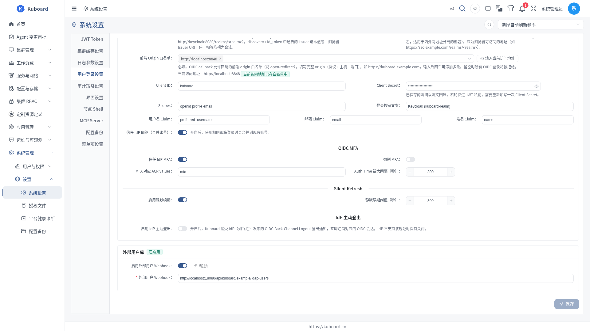
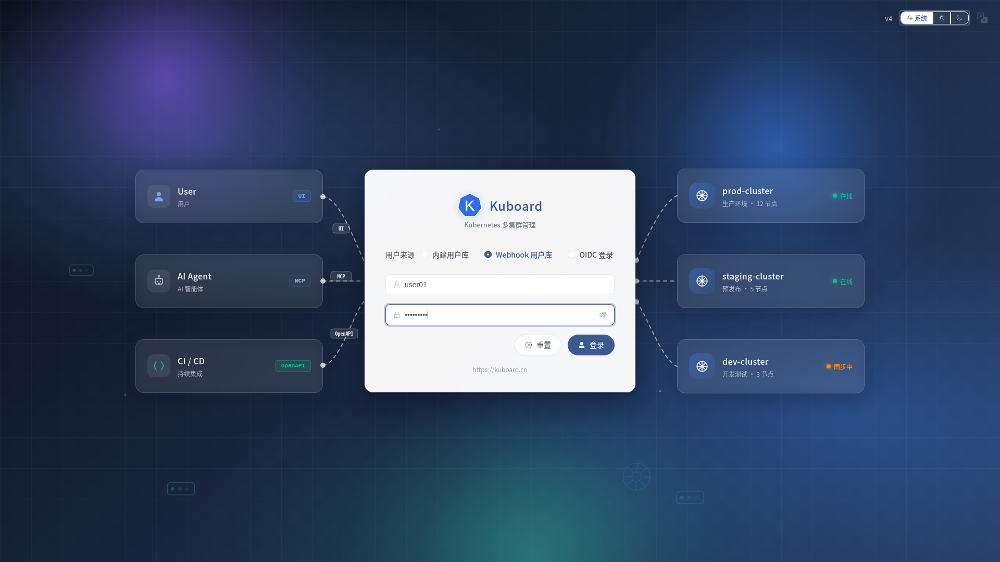
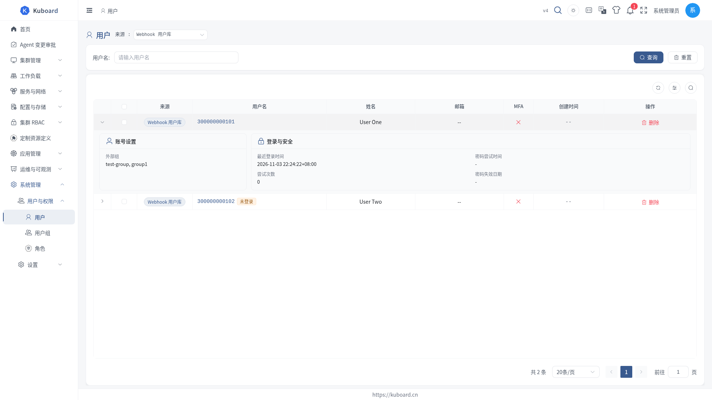

# 通过 Webhook 集成 LDAP

本页说明如何把企业已有的 LDAP 目录接入 Kuboard：用户在 Kuboard 登录页输入 LDAP 账号，密码交由 LDAP 校验。

**适用对象**：Kuboard 管理员；需要一个可运行的 HTTP 服务来承接 LDAP 校验。

::: warning 这不是单点登录（SSO）
用户仍要在 Kuboard 登录页输入用户名和密码，只是密码校验转发给了 LDAP。想让用户免输密码，请改用 [OIDC 单点登录](./oidc)。
:::

## 两种接入方式

| 方式 | 适合谁 | 说明 |
| --- | --- | --- |
| A. 用官方样例跑通一遍 | 想先确认 Kuboard ↔ LDAP 链路是否可用 | 拉起样例环境，改一个配置项即可登录 |
| B. 接入自己的 LDAP | 已有 LDAP，需要正式对接 | 基于样例改造，字段映射见下文 |

两种方式都是同一个原理：Kuboard 把登录请求转发给你指定的 HTTP 地址（称为「外部用户 Webhook」），由它去问 LDAP。

::: tip LDAP 侧已有 MFA 时请慎选
Kuboard 的 MFA 对 LDAP 用户同样生效：LDAP 校验通过后还要再输一次动态口令。若企业已在 LDAP 侧做了多因素认证，请改用 [OIDC 单点登录](./oidc)，由身份提供方统一处理。
:::

## 方式 A：用官方样例跑通一遍

### 1. 启动样例环境

```sh
git clone https://github.com/eip-work/kuboard-v4-ldap-example.git
cd kuboard-v4-ldap-example
docker compose up -d
```

样例会拉起 4 个容器：

| 容器 | 作用 | 访问方式 |
| --- | --- | --- |
| `openldap` | LDAP 目录服务 | 容器内 `ldap://openldap:1389` |
| `kuboard-ldap-example` | Webhook 服务，把 LDAP 查询翻译成 Kuboard 需要的格式 | 容器内 `http://ldap-example:9090/api/kuboard/example/ldap-users` |
| `db` | Kuboard 的数据库 | 容器内 `db:3306` |
| `kuboard` | Kuboard 本体 | 浏览器打开 `http://localhost:8000` |

LDAP 目录中预置了两个账号：

| 用户名 | 密码 | 所属组 |
| --- | --- | --- |
| `user01` | `password1` | `test-group` |
| `user02` | `password2` | `test-group` |

### 2. 在 Kuboard 中填写 Webhook 地址

1. 浏览器打开 `http://localhost:8000`，用 `admin` / `Kuboard123` 登录。
2. 进入 **系统管理 → 设置 → 系统设置 → 用户登录设置**，滚动到页面底部的「**外部用户库**」卡片。
3. 打开「**启用外部用户 Webhook**」开关，下方出现「**外部用户 Webhook**」输入框。
4. 填入 `http://ldap-example:9090/api/kuboard/example/ldap-users`，点「**保存**」。



::: warning 地址必须从 Kuboard 服务端可达
这个 URL 由 Kuboard **后端**发起请求，不是浏览器。请填 Kuboard 能解析并连通的地址；样例里 Kuboard 与 Webhook 服务在同一个 Docker 网络，所以用服务名 `ldap-example`，不要填 `localhost`。
:::

### 3. 用 LDAP 账号登录

1. 右上角头像 → **退出登录**。
2. 登录页「**用户来源**」选「**Webhook 用户库**」。
3. 输入 `user01` / `password1`，点「**登录**」；进入首页即表示链路已打通。



::: tip 密码不会进 Kuboard
Kuboard 只把密码转发给 LDAP，自己不保存。LDAP 侧改了密码，下次登录即生效。
:::

### 4. 给 LDAP 用户授权

LDAP 用户登录后默认**没有任何权限**（只能看到首页）。授权方式与内建用户完全一致：用户组 + 角色。

1. 进入 **系统管理 → 用户与权限 → 用户**，左上角「**来源**」切到「**Webhook 用户库**」。
2. 在列表中找到 `user01`，点开进入详情，切到「**关联用户组**」页签，点「**新增用户用户组绑定**」。
3. 选中一个已存在的 Kuboard 用户组（没有就先到 **系统管理 → 用户与权限 → 用户组** 新建一个），填写失效日期，点「**确定**」。



::: tip 也可以反着来
到 **用户组** 详情页的「**关联用户**」页签新增成员，搜索 `user01` 即可。首次绑定时 Kuboard 会自动为该 LDAP 用户建立本地记录，不用等他先登录。
:::

组绑好角色后，该组所有成员即刻生效；角色怎么绑见 [用户组](./groups)。

## 方式 B：接入自己的 LDAP

### Webhook 服务要做的事

在**同一个** HTTP 地址上实现 3 个动作（Kuboard 只认这一个地址）：

| 动作 | Kuboard 的请求 | 你要返回 |
| --- | --- | --- |
| 认证 | `POST {url}`，请求体 `{"username": "...", "password": "..."}` | `{"code": 0, "message": "ok"}` |
| 用户列表 | `GET {url}?pageNum=1&pageSize=10&username=` | `{"code": 0, "data": {"list": [...], "pageNum": 1, "pageSize": 10, "total": 1}}` |
| 查询单个用户 | `GET {url}?username=xxx` | 同上，`list` 里只有该用户 |

`code` 决定 Kuboard 如何处理：

| code | 含义 | Kuboard 的表现 |
| --- | --- | --- |
| 0 | 成功 | 认证通过 / 正常返回列表 |
| 1 | 认证失败 | 拒绝登录，提示用户名或密码错误 |
| 2 | 用户未找到 | 拒绝登录。为避免暴露账号是否存在，建议对「用户不存在」也返回 `code = 1` |
| 3 | 服务端内部错误 | 登录页提示网关错误 |

请求体与响应体的完整字段见 [Webhook 外部用户库](./webhook-users)。

### 从 LDAP 取哪些字段

| webhook 返回字段 | 对应的 LDAP 属性 | 必填 | 用途 |
| --- | --- | --- | --- |
| `username` | `uid` | 是 | 登录名，Kuboard 识别用户的唯一标识 |
| `fullName` | `cn` | 否 | 用户管理页「姓名」列 |
| `email` | `mail` | 否 | 用户管理页「邮箱」列 |
| `groups` | `memberOf` | 否 | 仅在用户管理页展示「外部组」，**不自动授予权限** |
| `createTime` | `createTimestamp` | 否 | 用户管理页「创建时间」列 |

### 改造官方样例

官方样例是一个 Spring Boot 应用，把 LDAP 查询换成你的目录即可：

1. 克隆样例仓库，改掉 LDAP 连接参数（见下表）。
2. 把样例里写死的用户组改为读取 `memberOf`（或你目录里对应的组属性）。
3. `docker build -t <你的镜像名>:v4 .`，推到 Kuboard 能访问的镜像仓库。
4. 把该服务部署到 Kuboard 可访问的网络里，在 Kuboard 中填入它的地址（同方式 A 的「在 Kuboard 中填写 Webhook 地址」一步）。

样例的连接参数：

| 环境变量 | 含义 | 样例默认值 |
| --- | --- | --- |
| `LDAP_URL` | LDAP 服务地址 | `ldap://localhost:1389` |
| `LDAP_USERNAME` | 绑定 LDAP 用的账号 | `cn=admin,dc=kuboard,dc=cn` |
| `LDAP_PASSWORD` | 绑定密码 | `Kuboard123` |
| `LDAP_BASE` | 用户所在的基础 DN | `ou=users,dc=kuboard,dc=cn` |

## 常见问题

| 现象 | 原因 | 处理 |
| --- | --- | --- |
| 登录页没有「Webhook 用户库」选项 | 没打开「启用外部用户 Webhook」，或改完没保存 | 回到「用户登录设置」确认开关已打开并保存 |
| 登录一直提示用户名或密码错误 | Webhook 地址连不上，或 LDAP 校验没通过 | 在 Kuboard 所在机器上执行 `curl -X POST <地址> -H 'Content-Type: application/json' -d '{"username":"user01","password":"password1"}'`，看返回的 `code` |
| 登录报网关错误 | Webhook 服务返回了 `code=3` 或抛出异常 | 查 Webhook 服务日志 |
| 用户管理页看不到 LDAP 用户 | 「来源」下拉没切到「Webhook 用户库」 | 切到「Webhook 用户库」；该列表是每次打开时实时向 LDAP 拉的 |
| LDAP 用户登录后什么都看不到 | 没绑定用户组 | 到「用户与权限 → 用户」找到该用户 → 关联用户组 |
| LDAP 里改了密码，Kuboard 仍提示错误 | Webhook 服务缓存了旧密码 | 检查 Webhook 服务的缓存；Kuboard 本身不缓存密码 |

## 安全建议

::: danger Webhook 会收到明文密码
用户的密码会以明文 POST 到你填的地址。请务必使用 HTTPS、限制来源 IP，并避免在返回的 `message` / `details` 里写入敏感信息。
:::

- 绑定 LDAP 时使用**只读**账号：Webhook 服务只需查询用户与组，不需要写权限。
- Kuboard 支持为发往 Webhook 的请求附加 HMAC 签名（配置项 `webhookSharedSecret`）。该字段暂未在界面上暴露，需要通过系统配置接口写入；配置后请在 Webhook 服务端校验 `X-Kuboard-Webhook-Signature` 请求头。
- 想让用户免输密码，请改用 [OIDC 单点登录](./oidc)。

## 相关页面

- [Webhook 外部用户库](./webhook-users) —— Webhook 协议的字段、返回码、启用与验证登录
- [用户组](./groups) —— 把 LDAP 用户纳入用户组并绑定角色
- [OIDC 单点登录](./oidc) —— 免输密码的另一种外部身份对接方式

本节涉及的接口详见 [Swagger UI 的「权限管理接口」分组](../reference/api)。
