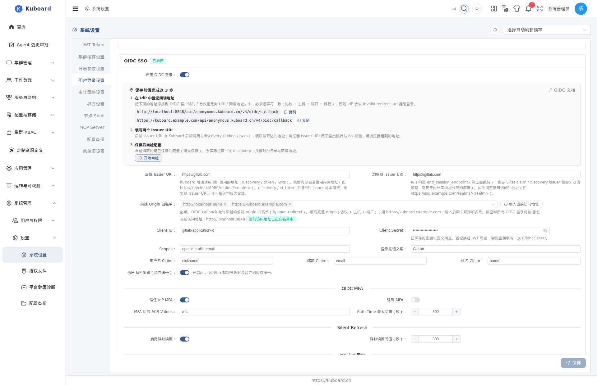

# 与 GitLab 集成（OIDC 单点登录）

把 GitLab 作为身份提供方（IdP）接入 Kuboard 后，团队成员用已有的 GitLab 账号登录 Kuboard，无需在 Kuboard 另建账号。本页面向管理员，按顺序完成 GitLab 与 Kuboard 两侧配置。

**适用对象**：Kuboard 管理员。

**前置条件**：

- Kuboard 已部署，管理员可通过浏览器访问（下文以 `https://kuboard.example.com` 为例）；
- 可用的 GitLab.com 或自建 GitLab（GitLab 的 OIDC Provider 为免费功能，CE / EE 均支持）；
- 已了解 Kuboard [OIDC 单点登录](./oidc) 的配置入口。

## 配置流程

| 步骤 | 在哪一步操作 | 做什么 |
| --- | --- | --- |
| 1 | GitLab | 创建 OAuth 应用，取得 Application ID 与 Secret |
| 2 | Kuboard | 在「系统管理 → 设置 → 系统设置 → 用户登录设置 → OIDC SSO」填写配置并保存 |
| 3 | Kuboard | 点「开始自检」，核对回调地址与白名单 |
| 4 | 两端 | 用 GitLab 账号验证登录 |

## 第一步：在 GitLab 创建 OAuth 应用

在 GitLab 中创建 OAuth 应用，并把它登记为 OpenID Connect 客户端。按你的组织方式选择一种应用类型，功能相同，仅可见范围不同：

| 类型 | 创建入口 | 适用场景 |
| --- | --- | --- |
| 组级（推荐） | 目标组 → Settings → Applications | 只允许该组成员登录 |
| 实例级 | Admin → Applications → New application | 自建 GitLab，全站成员登录（仅 Self-Managed，需管理员权限） |
| 用户级 | 头像 → Edit profile → Access → Applications | 个人试用 |

在新建应用页面填写：

| 字段 | 填写值 |
| --- | --- |
| Name | `Kuboard`（任意名称） |
| Redirect URI | `https://kuboard.example.com/api/anonymous.kuboard.cn/v4/oidc/callback` |
| Scopes | 勾选 `openid`、`profile`、`email` |

::: tip Redirect URI 可以直接复制
Kuboard 的 OIDC 卡片顶部会按白名单列出需要登记的回调地址，并提供「复制」按钮 —— 把地址粘到 GitLab 的 **Redirect URI** 即可，不必手工拼接。用户可能从多个地址访问 Kuboard（公网域名、内网域名、调试端口）时，**每个地址各登记一条**。
:::

点击 **Save application** 后，页面会给出两个值，请立即复制保存：

- **Application ID** —— 即 Kuboard 的 Client ID；
- **Secret** —— 即 Kuboard 的 Client Secret，只在创建时显示一次。

::: tip 实例级应用勾选 Trusted
在 Admin → Applications 创建实例级应用时勾选 **Trusted**，成员首次登录不再弹出授权确认页，直接完成登录。
:::

## 第二步：在 Kuboard 填写 OIDC 配置

入口：**系统管理 → 设置 → 系统设置 → 用户登录设置 → OIDC SSO**。打开「启用 OIDC 登录」后，卡片顶部会显示「保存前请完成这 3 步」引导（登记回调地址 → 填写两个 Issuer → 保存后自检），按表填写字段：

| 字段 | 填写值 | 说明 |
| --- | --- | --- |
| 后端 Issuer URI | `https://gitlab.com` 或 `https://gitlab.example.com` | GitLab 实例根地址，不带 `/oauth`、不带结尾 `/` |
| 浏览器 Issuer URI | 同上 | 浏览器访问地址与后端不同时（内外网分离）填外部地址，否则保持一致 |
| 前端 Origin 白名单 | `https://kuboard.example.com` | **必填**，输入后回车添加；也可点「填入当前访问地址」自动填入；填浏览器打开 Kuboard 时地址栏的「协议 + 域名 + 端口」 |
| Client ID | 第一步的 Application ID | |
| Client Secret | 第一步的 Secret | |
| Scopes | `openid profile email` | 默认值即可 |
| 登录按钮文案 | `GitLab` | 登录页按钮显示「使用 GitLab 登录」 |
| 用户名 Claim | `nickname` | GitLab 用户名；填 `preferred_username` 亦可（两者都在 id_token 中下发） |
| 邮箱 Claim | `email` | GitLab 主邮箱 |
| 姓名 Claim | `name` | GitLab 显示名 |
| 信任 IdP 邮箱（合并账号） | 开 | 邮箱与已有 Kuboard 账号相同时自动合并 |

保存后即时生效，无需重启。白名单条目会被自动规范化（去掉结尾 `/`、主机转小写、去重），输入框下方会实时提示「当前访问地址是否已在白名单中」。

**保存后点「开始自检」**：自检会用已保存的配置实际拉取一次 GitLab 的发现文档，并核对白名单与回调地址。期望看到「自检通过：discovery 可达、白名单与当前访问地址一致」，同时核对自检列出的回调地址与 GitLab 中 **Redirect URI** 逐字一致；有问题时按提示修正后重新保存再自检。

## 第三步：验证登录

1. 退出当前账号，回到登录页。OIDC 生效后，用户名 / 密码输入框被隐藏，只保留 **OIDC** 选项。
2. 点击「使用 GitLab 登录」，浏览器跳转到 GitLab 授权。
3. 首次登录如出现授权页，点击 **Authorize**（勾选了 Trusted 的实例级应用不会出现）。
4. 授权完成自动回到 Kuboard 首页，即登录成功；在 **用户管理** 中把「来源」筛选为 **OIDC**，可看到该用户。

**预创建账号（可选）**：希望成员首次登录前就分配好角色 / 用户组，可在用户管理页点 **+ 预创建 OIDC 用户**，填入与 GitLab 完全一致的邮箱（大小写敏感）。首次登录成功后占位行被替换为真实用户，原角色与组保留。

::: tip 登录失败时看提示
登录失败会回到登录页并给出**可行动的原因**，例如「当前访问 Kuboard 的地址不在 OIDC 白名单中」「IdP 拒绝了令牌交换」；若浏览器直接显示一个只带错误码的页面，说明失败发生在跳转 GitLab 之前（白名单为空或当前地址未登记），见下节。
:::

## 常见问题

### 个别用户登录后没有邮箱或显示名

GitLab 仅在应用勾选了 `email` scope、且该用户在 GitLab 设置了公开邮箱时才下发 `email` claim。到该用户的 GitLab 资料中补上公开邮箱即可；登录名始终由「用户名 Claim」保证，不受影响。

### 提示「id_token 校验未通过」

- 两个 Issuer URI 必须是 GitLab 实例根地址，不带 `/oauth`、不带结尾 `/`；
- 自建 GitLab 使用自签证书时，Kuboard 后端需信任该证书，否则拉取 discovery 失败；
- 内网 / 外网地址不一致时，「浏览器 Issuer URI」填浏览器可访问的地址。

### 浏览器直接显示错误页（而不是回到登录页）

这两种情况在**跳转 GitLab 之前**就被拒绝：

| 浏览器显示 | 含义 | 处理 |
| --- | --- | --- |
| 503 | 已启用 OIDC 但白名单为空 | 填写「前端 Origin 白名单」并保存 |
| 400 | 当前访问地址不在白名单内 | 把当前地址加入白名单，或改用已登记的地址访问 |

### GitLab 报 invalid redirect_uri 或登录提示「IdP 拒绝了令牌交换」

- GitLab 应用的 **Redirect URI** 必须与 `https://<Kuboard 域名>/api/anonymous.kuboard.cn/v4/oidc/callback` 完全一致（协议、域名、端口、路径均不能差）；
- Client ID / Secret 与 GitLab 中不一致（常见于在 GitLab 执行过 **Renew secret** 后未同步更新）—— 重新复制并保存；
- 必要时在 GitLab 侧确认该应用未被禁用。

## 相关文档

[OIDC 单点登录](./oidc) · [登录页与各认证方式](./login) · [用户列表与用户管理](./users) · [用户组](./groups)
