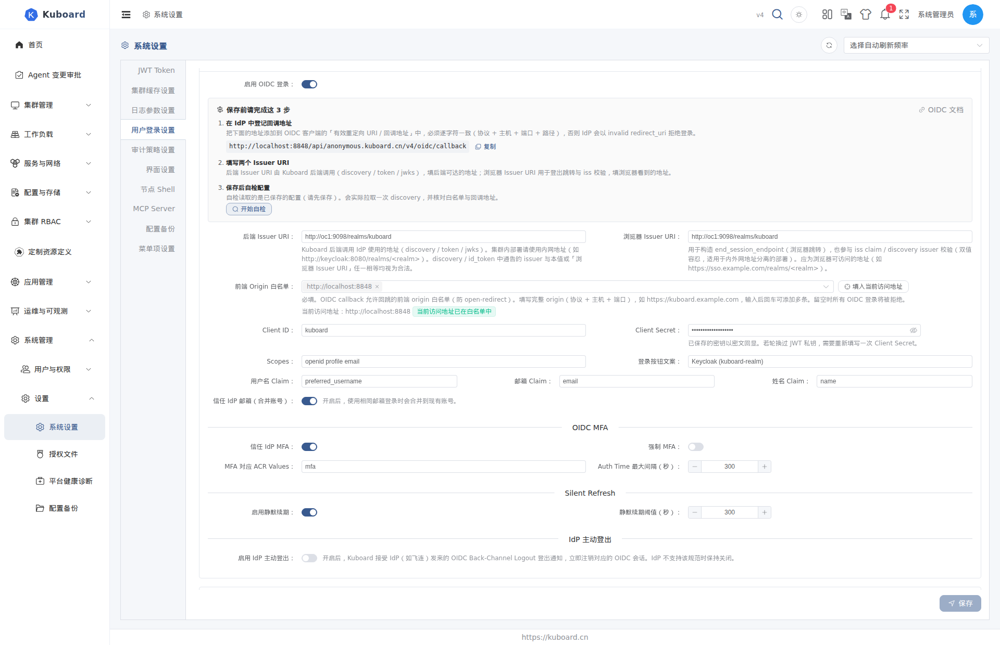
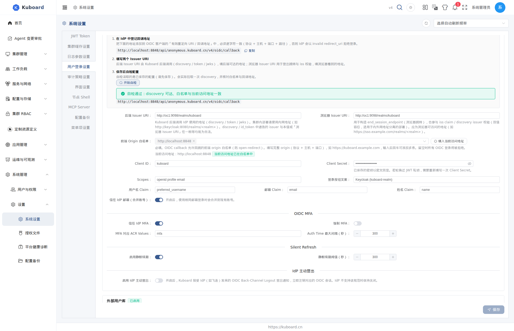

# Kuboard OIDC 单点登录（SSO）

本页说明管理员如何为 Kuboard 接入 OIDC 单点登录、接入后如何自检，用户如何用 IdP 账号登录与登出，以及登录失败时如何排查。

**适用对象**：管理员（配置 OIDC、管理 OIDC 用户）与普通用户（点「使用 XXX 登录」）。

## 接入流程一览

Kuboard 采用**单 IdP** 形态：所有 OIDC 字段集中在同一张卡片（**系统管理 → 设置 → 系统设置 → 用户登录设置 → OIDC SSO**），没有向导页签、没有多 IdP 列表。

| 步骤 | 谁做 | 在哪做 |
|---|---|---|
| ① 登记回调地址 | 管理员 | IdP 客户端的「有效重定向 URI / 回调地址」 |
| ② 填写 OIDC 卡片 | 管理员 | Kuboard 系统设置 → 用户登录设置 |
| ③ 保存后自检 | 管理员 | 同一张卡片上的「开始自检」 |
| ④ 点按钮登录 | 用户 | 登录页「使用 XXX 登录」 |

打开「启用 OIDC 登录」后，卡片顶部会显示「**保存前请完成这 3 步**」引导，把 ① ② ③ 摆在配置项正上方：回调地址可一键复制，最后一步就是「开始自检」按钮。按引导顺序做即可，下面各节是逐步说明。

## 用户：登录与登出

### 登录

OIDC 启用且白名单非空时，登录页默认选中用户来源「OIDC」并隐藏用户名 / 密码输入框。点「使用 {显示名称} 登录」→ 整页跳转到 IdP → 在 IdP 完成认证（若 IdP 侧配了 MFA 则含二次验证）→ 自动回到 Kuboard 首页。首次登录会自动创建本地账号。

### 登录失败时看到的提示

失败会回到登录页并给出可直接处理的原因（不再只显示错误码）：

| 页面提示 | 常见原因与处理 |
|---|---|
| 登录会话已过期或被重复使用 | 回到登录页重新点「使用 {显示名称} 登录」；反复出现请检查反向代理是否改写了回调地址 |
| IdP 拒绝了令牌交换 | IdP 中登记的回调地址与当前访问地址不一致、Client Secret 不正确、或客户端在 IdP 侧被禁用 |
| id_token 校验未通过 | 两个 Issuer URI 是否属于同一个 Realm、服务器时间是否准确 |
| 当前访问 Kuboard 的地址不在 OIDC 白名单中 | 请管理员在 **系统设置 → 用户登录设置 → OIDC SSO** 把当前地址加入白名单 |
| 已启用 OIDC 但回调白名单为空 | 请管理员先填写白名单，否则所有 OIDC 登录都会被拒绝 |
| IdP 未完成 MFA / IdP MFA 已过期 | 到 IdP 重新完成 MFA 认证后重试 |

个别失败发生在**跳转 IdP 之前**（白名单为空或当前地址不在白名单），此时浏览器会直接显示一个只带错误码的页面，不会回到登录页 —— 处理见 [常见问题排查](#点登录后浏览器直接显示错误页-而不是回到登录页)。

### 单点登出

点右上角**登出**：

1. Kuboard 删除本地会话；
2. 浏览器跳到 IdP 的登出端点，注销单点会话；
3. 回到 Kuboard 登录页。

若 IdP 没有提供登出端点，则只完成本地登出，需要用户自行关闭 IdP 会话。需要「在 IdP 侧登出后，Kuboard 会话立刻失效」的场景，见 [IdP 主动登出](#idp-主动登出-back-channel-logout)。

### 令牌续期

无需用户操作：本地令牌临近过期时由系统自动续期，用户无感知。行为由管理员的[静默续期](#静默续期)配置决定。

## 管理员：配置 OIDC

### 第一步：在 IdP 中登记回调地址

回调地址 = 用户访问 Kuboard 的地址 + 固定路径：

```sh
https://<kuboard 域名>/api/anonymous.kuboard.cn/v4/oidc/callback
```

- 必须**逐字符一致**（协议 + 主机 + 端口 + 路径），否则 IdP 会以 `invalid redirect_uri` 拒绝登录；
- 用户会从多个地址访问时（公网域名 + 内网域名 + 调试端口），**每个地址各登记一条**；
- 卡片上的引导会按白名单逐条列出这些地址并支持复制，不必手工拼接。

以 Keycloak 为例：**Clients → Create client**，Client type 选 **OpenID Connect**，Client ID 填 `kuboard`，勾选 **Client authentication** 与 **Standard flow**；把上面的回调地址填入 **Valid redirect URIs**；到 **Credentials** 页复制 **Client secret** 留待下一步；记下 Realm 的 issuer 地址（形如 `https://sso.example.com/realms/kuboard`）。

### 第二步：填写 OIDC 配置

入口：**系统管理 → 设置 → 系统设置 → 用户登录设置 → OIDC SSO**，打开「启用 OIDC 登录」后展开全部字段。



| 字段 | 示例 | 说明 |
|---|---|---|
| 启用 OIDC 登录 | 开 | 关闭后登录页不再出现 OIDC 入口 |
| 登录按钮文案 | `Keycloak SSO` | 登录按钮显示为「使用 Keycloak SSO 登录」 |
| 后端 Issuer URI | `http://keycloak:8080/realms/kuboard` | Kuboard 后端访问 IdP 用，必须后端可达（集群内网或宿主机地址） |
| 浏览器 Issuer URI | `https://sso.example.com/realms/kuboard` | 浏览器跳转与登出用；内外网地址不同时填写 |
| **前端 Origin 白名单** | `https://kuboard.example.com` | **必填**，可多条，详见下节 |
| Client ID | `kuboard` | 与 IdP 中一致 |
| Client Secret | 上一步复制的 secret | 保存后以密文回显；轮换过 JWT 私钥需重新填写一次 |
| Scopes | `openid profile email` | 默认即可；需要 refresh_token 续期时加 `offline_access` |
| 用户名 Claim | `preferred_username` | Kuboard 用户名 |
| 邮箱 Claim | `email` | 邮箱（预绑定匹配与合并） |
| 姓名 Claim | `name` | 显示名 |
| 信任 IdP 邮箱（合并账号） | 开 | IdP 返回的邮箱与本地用户相同时合并为同一账号；关闭则视为新身份 |

Issuer 两个字段有内置校验：必填、必须以 `http://` 或 `https://` 开头、不能以 `/` 结尾（失焦时会自动去掉结尾斜杠）。

#### 前端 Origin 白名单怎么填

白名单是「用户可能从哪些地址打开 Kuboard」的清单，至少一条。填写方式：

1. 在输入框里输入完整 origin（协议 + 主机 + 端口，如 `https://kuboard.example.com`），回车添加；
2. 或直接点「**填入当前访问地址**」，把浏览器正在访问的地址加进白名单（大多数部署就是这一条）。

输入框下方会实时显示「当前访问地址：…」以及它是否已在白名单中：绿色「当前访问地址已在白名单中」表示可用；黄色「当前访问地址不在白名单中，从这里登录会被拒绝」表示还需要补一条。

| 场景 | 白名单应填 |
|---|---|
| 单实例 + 单域名 | `https://kuboard.example.com` |
| 同实例多端口（开发 8848 / 预发 8849） | `http://localhost:8848`、`http://localhost:8849` |
| 反向代理 + 根域 / 子域 | `https://kuboard.example.com`、`https://ui.kuboard.example.com` |

条目会被自动规范化（去掉结尾 `/`、主机转小写、去重），并提示「已自动规范化部分条目，请确认后保存」。保存时还会校验：至少一条，每条必须是 `协议://主机[:端口]`（不能带路径、结尾斜杠或缺少协议）。

::: warning 只填域名开头是不够的
白名单比较的是**完整 origin**：`https://kuboard.example.com` 与 `https://kuboard.example.com:8443` 是两条不同的记录，端口不同必须分别登记。
:::

### 第三步：保存后自检

**先保存**，再点卡片上的「**开始自检**」。自检读取的是已保存的配置，会实际拉取一次 IdP 的发现文档，并核对白名单与回调地址。

自检结果按严重程度分三类：

| 级别 | 含义 | 是否阻断登录 |
|---|---|---|
| 阻塞问题 | 必须修正 | 是，登录一定会失败 |
| 风险 | 建议修正 | 否，但特定场景会失败 |
| 提示 | 知会 | 否 |

同时会列出「**需要在 IdP 登记的回调地址**」，可与 IdP 侧逐条比对。常见结论对照：

| 自检提示 | 处理 |
|---|---|
| 白名单为空 | 至少填一条用户实际访问 Kuboard 的地址，否则登录在跳 IdP 之前就被拒绝 |
| 白名单条目不是合法 origin | 改成 `协议://主机[:端口]`，去掉路径与结尾斜杠 |
| 白名单条目存在多余字符 | 运行时按规范化后的值匹配，建议直接把配置改成规范化后的值 |
| 白名单条目使用 http | 部分 IdP（Azure AD / Auth0 / Google 等）只接受 https 重定向地址 |
| 当前访问地址不在白名单中 | 用当前地址登录会被拒绝，补一条或换用已登记的地址访问 |
| 后端 Issuer URI 为空 | OIDC 接口不可用，补齐后重新保存 |
| 后端 Issuer URI 以 `/` 结尾 | 发现文档地址会变成 `//.well-known/...`，多数 IdP 返回 404，去掉结尾斜杠 |
| 浏览器 Issuer URI 为空 | 登出跳转与 issuer 双值校验不可用，补上浏览器可达的地址 |
| Client Secret 为空 | 只有公共客户端可以留空，机密客户端会在令牌交换阶段失败 |
| Client Secret 无法解密 | 通常是轮换过 JWT 私钥或 OIDC 加密密钥，重新填写一次 Client Secret 并保存 |
| 拉取 discovery 失败 | 后端 Issuer URI 必须是 Kuboard 后端可达的地址，且与 IdP 通告的 issuer 一致 |
| IdP 未提供 end_session_endpoint | 登出只清 Kuboard 会话，不注销 IdP 会话 |



自检通过后，按[用户：登录与登出](#用户-登录与登出)验证一次：登录页点「使用 {显示名称} 登录」→ 跳 IdP 认证 → 回到 Kuboard 首页 → 用户列表出现该用户（来源 OIDC）。

## 配置参考

### Issuer 双值：内网 / 外网两个 URI

「后端 Issuer URI」供 Kuboard 后端访问 IdP（拉取发现文档、换令牌、取公钥），必须**后端可达**；「浏览器 Issuer URI」供浏览器跳转与登出，填浏览器看到的地址。内外网地址一致时两个字段填同一个值。

Kuboard 同时接受发现文档返回的 issuer 等于这两个值中的**任意一个**，因此「后端走内网地址拉取，IdP 通告的是外网地址」也能正常工作。

唯一会被拒绝的情况：两个 URI 都不是 IdP 通告的 issuer（典型反例：IdP 通告 `https://sso.example.com/realms/kuboard`，而你把两个字段都填成 `http://keycloak:8080/realms/kuboard`）。

### Claims 映射

各 IdP 的 claim 命名略有出入，三个字段做映射对照；若你的 IdP 用其它 claim（如 `sub`、`upn`），把对应字段改成放登录名的 claim 即可。

| 字段 | 默认 claim | 用途 |
|---|---|---|
| 用户名 Claim | `preferred_username` | Kuboard 用户名 |
| 邮箱 Claim | `email` | 邮箱（预绑定匹配与合并） |
| 姓名 Claim | `name` | 显示名 |

**信任 IdP 邮箱（合并账号）**（默认开启）：IdP 返回的邮箱与本地其它来源用户相同时自动合并，实现「同一人多方式登录」；关闭则每次登录都视为新身份。

### MFA 策略

OIDC 用户的 MFA 由 **IdP 负责**，Kuboard 依据 id_token 中的标准声明判断本次登录是否完成 MFA：

| 字段 | 默认 | 行为 |
|---|---|---|
| 信任 IdP MFA | 开 | 依据 IdP 下发的 MFA 相关声明判断；关闭则一律视为未启用 |
| 强制 MFA | 关 | 未在 IdP 完成 MFA 的登录被**拒绝**（回登录页提示原因） |
| MFA 对应 ACR Values | `mfa` | 发起授权时携带的参数，告知 IdP 此次登录要求 MFA |
| Auth Time 最大间隔（秒） | `300` | 认证完成时间距现在超过该秒数视为「MFA 已过期」；0 关闭检查 |

::: warning 开启强制前先确认 IdP 下发相关声明
部分 IdP 默认不下发认证时间或认证方式声明，此时启用「强制 MFA」会导致所有人登录被拒。请先在 IdP 侧确认能下发，再打开该开关。
:::

### 静默续期

IdP 下发 refresh_token（需 `offline_access` scope）时，本地令牌临近过期会自动续期，**用户完全无感**：

| 字段 | 默认 | 行为 |
|---|---|---|
| 启用静默续期 | 开 | 令牌过期前自动用 refresh_token 续期；关闭则到期跳回登录页 |
| 静默续期阈值（秒） | `300` | 距过期剩余时间小于该秒数时触发；最低 30 |

### IdP 主动登出（Back-Channel Logout）

默认**关闭**。开启后，用户在 IdP 侧登出时，IdP 会向 Kuboard 投递一条登出通知（OIDC Back-Channel Logout 1.0 规范），Kuboard 随即注销该用户由 IdP 签发的会话 —— **已签发的访问令牌立即失效**，不必等它自然过期。

| 字段 | 默认 | 行为 |
|---|---|---|
| 启用 IdP 主动登出 | 关 | 关闭时该地址不接受任何登出通知；IdP 不支持该规范时保持关闭即可 |

开启后卡片会显示「**单点登出地址**」，把它填到 IdP 侧的单点登出 / Single Logout URL 字段：

```sh
https://<kuboard 域名>/api/anonymous.kuboard.cn/v4/oidc/backchannel-logout
```

Kuboard 侧会校验通知的签名、签发方、受众、时间与事件类型，任一不通过即拒绝；普通 id_token 不能被当作登出通知重放。会话按通知中的用户标识定位，IdP 额外下发会话标识时只注销对应会话，否则注销该用户的全部 OIDC 会话。

::: tip 适用范围
该功能只作用于 **OIDC 登录**的会话；内建用户库 / 外部用户库登录不受影响。升级前已存在、且此后未发生过静默续期的 OIDC 会话，需要重新登录一次才能被主动登出命中。
:::

## 管理员：管理 OIDC 用户

**查看列表**：用户列表把「来源」筛选切到 **OIDC**（仅启用时出现），展示用户名、显示名、邮箱、状态，可搜索与批量删除。

**预创建账号（预绑定）**：想在首次登录前确定账号（分配角色 / 组），点列表页 **「+ 预创建 OIDC 用户」**：① 填 **邮箱**，必须与 IdP 的邮箱 claim **完全一致**（大小写敏感）；② 可选填显示名，保存后出现「待首次登录」占位行；③ 首次登录成功后占位行替换为真实用户，原角色 / 组保留。若登录后出现的是新用户而非合并到占位行，通常是邮箱与 IdP 不一致，请核对大小写与域名后缀。

## 常见问题排查

### 登录页没有「OIDC 登录」入口

- 检查 **OIDC SSO → 启用 OIDC 登录** 是否打开，且白名单至少有一条；
- 检查用户来源是否选在「OIDC」；
- 保存后配置即时生效，无需重启；若页面仍无变化，刷新登录页重试。

### 点登录后浏览器直接显示错误页（而不是回到登录页）

这两种情况在**跳转 IdP 之前**就被拒绝，因此浏览器显示的是错误页：

| 浏览器显示 | 含义 | 处理 |
|---|---|---|
| 503（`oidc_allowed_origins_not_configured`） | 已启用 OIDC 但白名单为空 | 填写白名单并保存 |
| 400（`oidc_origin_not_allowed`） | 当前访问地址不在白名单内 | 把当前地址加入白名单，或改用已登记的地址访问 |

### 自检 / 健康诊断提示 OIDC 有问题

- 卡片上的「开始自检」给出逐条结论，见[第三步：保存后自检](#第三步-保存后自检)；
- **系统管理 → 设置 → 健康诊断**页在 OIDC 启用时会额外检查 4 项：白名单为空、Issuer 不完整或带结尾斜杠、Client Secret 无法解密、Client Secret 为空，并可直接跳到登录设置修改。

### Issuer 发现文档拉取失败

- 后端 Issuer URI 必须是 **Kuboard 后端进程**可达的地址；容器内与宿主机可达性不同，注意区分；
- 公网地址确认域名解析与证书有效；
- 自检报拉取失败时，先确认该地址能直接在浏览器打开 `.well-known/openid-configuration`；
- 本地容器化调试时，Kuboard 后端若跑宿主机上，IdP 地址要用**宿主机可达的主机名与映射端口**，而不是容器内网名称。

### 登出后 IdP 会话未注销

正常路径：本地会话删除 → 顶层跳转到 IdP 登出端点 → IdP 显示登出页 → 回到登录页。若只完成了本地登出，说明当前 IdP 的发现文档未提供登出端点（部分老版本 Okta / Entra ID），此时需要用户手动关闭 IdP 会话；需要「IdP 侧登出即刻踢掉 Kuboard 会话」时改用 [IdP 主动登出](#idp-主动登出-back-channel-logout)。

### 回调地址与反向代理

回调地址由白名单里的前端 origin 拼出，不再依赖代理透传的地址头，因此**白名单必须写用户浏览器实际访问的地址（含端口）**。反向代理的其它注意事项见 [反向代理](../install/reverse-proxy.md)。

## 相关文档

[登录页与各认证方式的关系](./login) · [MFA 多因素认证](./mfa) · [用户列表与用户管理](./users) · [密码策略与修改密码](./password) · [与 GitLab 集成](./oidc-gitlab)

## 接口文档

本节涉及的接口详见 [Swagger UI 的「OIDC」与「健康诊断」分组](../reference/api)。